# FT8-Horch: die Anleitung

*Bedienungsanleitung für eine App, die eigentlich nur ein kleines Skript werden sollte.*

## Wie es dazu kam

Ich beschäftige mich schon länger mit FT8. Irgendwann reicht es einem nicht mehr, dass etwas funktioniert. Man will wissen, *wie*. Also habe ich mich durch die Spezifikationen gearbeitet, was ungefähr so aufregend ist, wie es klingt, und mir das Ergebnis anschließend in einem Blogartikel von der Seele geschrieben: [FT8 – Mathematik statt Watt](https://ohrenbeisser.de/ft8-mathematik-statt-watt/).

Damit hätte es gut sein können. War es aber nicht.

Der Plan war nämlich bescheiden: ein kleines Skript, das zeigt, wie aus einer Nachricht wie `CQ DL6LG JO60` erst ein Bitmuster wird und aus dem Bitmuster dann ein Signal. (Das kann die App übrigens bis heute, es steckt im Reiter *Codierung*.)

Dann kam der Gedanke: Wenn das Signale sind, kann man sie auch hörbar machen. Und wenn man sie hören kann, kann man sie mit dem Mikrofon wieder aufnehmen. Und wenn man sie aufnimmt, kann man versuchen, sie zu decodieren. Und wenn das klappt ... na ja, du siehst, wohin das führt. Warum dann nicht gleich ein komplettes FT8-QSO?

So wurde aus dem kleinen Skript eine App. Sie heißt **FT8-Horch**, und wer sich fragt, ob das nicht eine Nummer zu groß geraten ist: Ja. Aber sie funktioniert tatsächlich, und das ist für ein Projekt, das mit „nur mal eben ein Skript“ angefangen hat, schon eine ganze Menge.

## Das Wichtigste in drei Minuten

Du hast keine Lust auf Handbücher? Verständlich. Hier die Kurzfassung:

1. Unten auf **Einstell.** tippen, dein Rufzeichen und deinen Locator eintragen (zum Beispiel `DL6LG` und `JO60`).
2. Am Gerät die **automatische Uhrzeit** einschalten. Die Uhr muss auf die Sekunde stimmen, mehr dazu gleich.
3. Zurück zum Reiter **QSO**, den **Mikrofon-Schalter** (links Mikrofon durchgestrichen, rechts Mikrofon) nach rechts schieben und die Frage nach der Mikrofon-Erlaubnis mit „Ja“ beantworten.
4. Ein zweites Gerät mit der App danebenlegen (oder ein echtes FT8-Signal aus dem Lautsprecher abspielen). Ruft das andere Gerät CQ, antwortet die App von allein, denn der Schalter **Auto-Antwort** über der Band-Aktivität ist beim Start an. Alternativ tippst du auf eine Zeile mit grünem Rand. Fertig, die App fährt das QSO von allein.

Ein Gerät, das CQ ruft, und eins, das antwortet: mehr braucht es nicht. Der Rest ist Feinschliff.

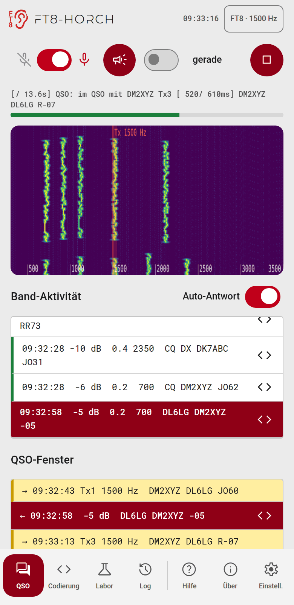

## Was FT8-Horch kann (und was lieber nicht)

FT8-Horch fährt FT8-QSOs über **Lautsprecher und Mikrofon**. Kein Funkgerät, kein Kabel, kein Antennenmast. Zwei Geräte nebeneinander auf dem Tisch reichen, oder ein Handy und ein PC. Die App sendet, hört mit, decodiert und antwortet nach den üblichen Regeln der Auto-Sequenz: von CQ bis 73.

Dazu kommen ein paar Dinge, die man für den Spaß an der Sache nicht unbedingt braucht, aber eben schon da sind:

* Die Zeit lässt sich dehnen (15, 30, 60 oder 120 Sekunden) und der Tonabstand einstellen. Das nennt sich dann *Profil*.
* Die **Auto-Antwort** beantwortet das erste CQ, das die App hört, von allein.
* Der Reiter *Codierung* zeigt Schritt für Schritt, wie aus einer Nachricht Töne werden und umgekehrt.
* Das *Labor* misst Pegel und Laufzeit und simuliert Signale mit Rauschen.
* Ein *Log* mit ADIF-Export und -Import, ein Textprotokoll und eine Sicherung aller Daten gibt es auch.
* Im *Labor* testest du außerdem zwei Geräte gegeneinander (**Verbindungstest**) und speicherst Aufnahmen als WAV-Datei oder decodierst fremde WAV-Dateien.

Und jetzt die ehrlichen Grenzen, damit du dich nicht wunderst:

* Es gibt Standardnachrichten (Rufzeichen, Locator, Rapport, RR73, 73) und Freitext bis 13 Zeichen. Rufzeichen mit `/P` und besonders lange oder ungewöhnliche Rufzeichen (die mit dem Hash-Trick, Typ 4) kann die App nicht, und das ist auch nicht geplant. Solche Nachrichten zeigt sie als „nicht unterstützt“ an.
* Auf einem vollen Band findet FT8-Horch weniger Nachrichten als WSJT-X. In einem Vergleich mit 60 Bandaufnahmen waren es 67,7 Prozent der Nachrichten, die WSJT-X gefunden hat. WSJT-X hat Tricks wie das Abziehen schon decodierter Signale, die hier fehlen und nicht geplant sind.
* Die Signalform ist FT8-konform: WSJT-X hat eine mit der App erzeugte WAV-Datei decodiert. Wie sich die App an einem echten Funkgerät schlägt, habe ich aber noch nicht ausprobiert.
* Getestet habe ich auf einem Pixel 10a, einem alten Tablet mit Android 10 und einem PC, jeweils mit Chrome. Auf anderen Geräten und Browsern kann es anders laufen, auf dem iPhone weiß ich es schlicht nicht.

## Erste Schritte

### Rufzeichen und Locator

Die Einstellungen erreichst du unten über **Einstell.** (auf breiten Bildschirmen steht dort „Einstellungen“). Dort tragen sich zuerst Rufzeichen und Locator ein. Der Locator hat vier Zeichen, etwa `JO60`.

Wenn du deinen Locator nicht auswendig weißt, tippe auf das Symbol mit dem Fadenkreuz neben dem Feld. Dann fragt der Browser nach deinem Standort, und die App rechnet daraus den Locator aus. Das passiert ausschließlich auf deinem Gerät, die Koordinaten werden weder gespeichert noch irgendwohin geschickt. Du kannst den Locator jederzeit von Hand überschreiben.

Änderungen gelten sofort, einen Speichern-Knopf gibt es nicht. Wenn Rufzeichen oder Locator nicht gültig sind, meldet die App das mit einem gelben Band, und CQ rufen geht dann nicht.

Darunter stellst du Sprache (Deutsch oder Englisch) und Darstellung (nach dem System, hell oder dunkel) ein. In der Karte **Automatik** legst du fest, ob die Auto-Antwort Stationen überspringt, die schon in deinem Log stehen: nur die von heute (UTC, die Vorgabe), alle aus dem ganzen Log oder keine. Dort stellst du auch ein, ob die App beim Antworten die Frequenz der Gegenstelle übernimmt oder deine eigene hält, und ob sie nach einem QSO aus deinem eigenen CQ weiter CQ ruft (mehr dazu bei „CQ rufen oder antworten“).

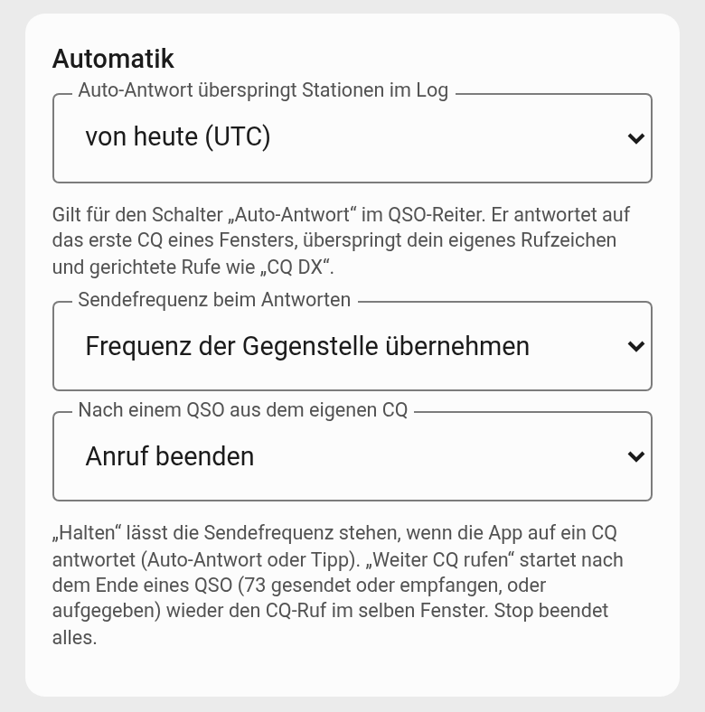

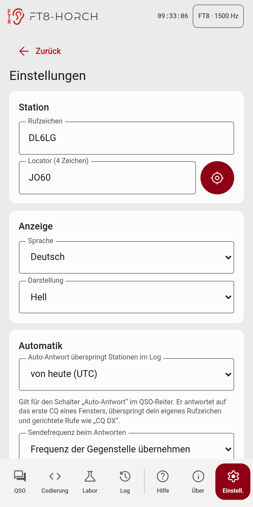

### Die Uhr muss stimmen

Jetzt das Thema, über das ich selbst gestolpert bin: FT8 arbeitet im 15-Sekunden-Takt nach Weltzeit (UTC). Alle Stationen senden zur gleichen Sekunde los und hören zur gleichen Sekunde zu. Stimmt die Uhr eines Geräts nicht, kommt das Signal des anderen zu früh oder zu spät an, und irgendwann gar nicht mehr.

Mein Test-PC ging einmal 18 Sekunden falsch. FT8 verzeiht vieles, aber keine 18 Sekunden.

Deshalb gilt: Schalte am Gerät die automatische Uhrzeit ein (bei Android heißt das meist „Datum und Uhrzeit automatisch“). Die App stellt die Uhr deines Geräts **nie** um, das darf eine Web-App gar nicht. Sie arbeitet immer mit der Systemzeit.

Was die App kann, ist nachsehen, ob die Uhr stimmt. Unter **Uhr** in den Einstellungen tippst du auf **Uhr prüfen**. Die App fragt dann den Server, von dem sie geladen wurde, neunmal nach der Uhrzeit und rechnet aus, wie weit dein Gerät danebenliegt. Du bekommst zum Beispiel „Uhr stimmt (Abweichung +0,1 s ± 0,1 s)“. Das „±“ ist die Messunsicherheit, die Prüfung ist also auf etwa ein Zehntel Sekunde genau, nicht auf die Millisekunde. Beim Start läuft die Prüfung einmal von allein, wenn du online bist.

Weicht die Uhr um mehr als 0,4 Sekunden ab, erscheint im QSO-Reiter ein Warnband. Dann gibt es die Notlösung **In der App ausgleichen**: Die App verschiebt ihre eigene Uhr um die gemessene Abweichung, bis du die Seite neu lädst. Das Gerät selbst bleibt unverändert. Besser ist es, die Uhr richtig zu stellen. Der Ausgleich ist ein Pflaster, keine Operation.

Wer den Ausgleich nicht jedes Mal von Hand drücken will, stellt in der Karte **Uhr** die **Zeitquelle** von *Systemzeit des Geräts* auf *Serverzeit*. Dann fragt die App beim Start und danach alle zehn Minuten den Server nach der Uhrzeit und gleicht die Abweichung selbst aus, auf etwa eine Zehntelsekunde genau. Das ist praktisch, wenn die Uhr des Geräts falsch geht oder zwei Geräte sich nicht auf dieselbe Zeit einigen können, denn beide richten sich dann nach demselben Server. Mitten in einem QSO ändert die App nichts, damit die Fenster nicht springen. Ohne Netz rechnet sie mit der Systemzeit weiter und sagt das auch. Die Uhr des Geräts bleibt in jedem Fall unangetastet.

Vorsicht bei der Wahl der Quelle: Die Serverzeit ist nur so gut wie die Uhr des Servers, von dem die App geladen wurde. Bei einem normalen Webserver ist das unproblematisch, wenn du die App aber von einem selbst betriebenen PC lädst, der falsch geht, hilft dir diese Einstellung nicht.

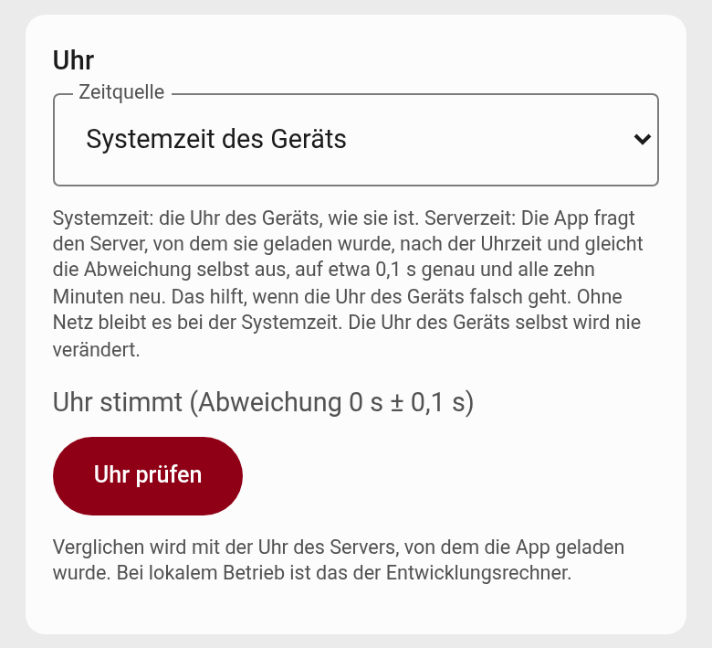

Wo kein Netz ist, kann die App den Server nicht fragen. Dann meldet sie „Zeitprüfung nicht möglich (offline?)“ und vertraut deiner Systemzeit.

### Daten sichern

Log, Protokoll und Einstellungen liegen nur in deinem Browser. Löschst du die „Websitedaten“, wechselst du das Handy oder macht der Browser bei Platzmangel Platz, sind sie weg. Unter **Einstellungen, Daten sichern** gibt es dagegen zwei Schaltflächen:

* **Sicherung speichern** schreibt alles in eine Datei `ft8-horch-sicherung_<Datum>.json`: alle QSOs, das Protokoll und Rufzeichen, Locator, Sprache, Aussehen, Profil, Sendefrequenz, Zeitquelle und Auto-Antwort-Wahl. Hebe die Datei an einem sicheren Ort auf. Sie enthält auch die Rufzeichen der Stationen, die du gehört hast.
* **Sicherung einlesen** liest so eine Datei wieder ein. Du bekommst vorher eine Rückfrage mit den Zahlen. Es wird nur ergänzt: QSOs und Protokollzeilen, die schon da sind, bleiben und werden nicht doppelt angelegt, die Einstellungen aus der Datei werden übernommen (leeres Rufzeichen und leerer Locator überschreiben nichts, Zeit und Tonabstand ändern sich während eines QSO nicht). Unbrauchbare Einträge überspringt die App und zählt sie.

Darunter steht, ob der Browser die Daten **dauerhaft** hält. Die App bittet den Browser darum, sobald du ein QSO speicherst. Chrome entscheidet das selbst (installierte App und häufige Nutzung helfen). Steht dort „darf löschen“, ist die Sicherung umso wichtiger.

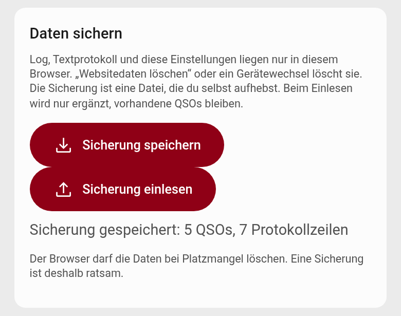

### Als App auf den Startbildschirm

FT8-Horch ist eine PWA, das ist eine Webseite, die sich wie eine App benimmt. Wenn du sie über eine sichere Adresse (https) öffnest, kannst du sie installieren. Sie bekommt dann das Ohr als Symbol und startet ohne Browserleiste.

Dafür gibt es zwei Wege. Unter **Einstellungen** steht ganz unten die Karte **App installieren**. Ist die Installation möglich, hat sie einen Knopf, sonst erklärt sie, was du tun kannst: In Chrome auf Android findest du es im Menü (die drei Punkte) unter **App installieren** oder **Zum Startbildschirm hinzufügen**, auf dem iPhone über das Teilen-Symbol von Safari und **Zum Home-Bildschirm**. Außerdem weist dich die App beim dritten Start **einmal** darauf hin, mit den Knöpfen „Installieren“ und „Nein danke“. Danach lässt sie dich in Ruhe, versprochen. Ist die App schon installiert, schweigt sie ohnehin.

Beim ersten Laden legt die App alle Dateien im Zwischenspeicher des Browsers ab. Danach läuft sie auch ohne Netz, nur die Zeitprüfung braucht eine Verbindung.

Wenn es eine neue Version gibt, lädt die App sich von selbst neu, solange das Mikrofon aus ist und kein QSO läuft. Sonst erscheint ein Hinweis, die Seite danach neu zu laden. Unter **Über** steht in der Zeile **Dateien (Cache)**, welche Fassung gerade geladen ist (zum Beispiel `horch-80`).

## Die Oberfläche im Überblick

Oben steht die Kopfzeile: links das Logo und der Name, in der Mitte die Weltzeit (UTC) mit Sekunden, rechts der **Profil-Chip**. Er zeigt, mit welchem Profil du gerade arbeitest, zum Beispiel „FT8 · 1500 Hz“. Ein Tipp darauf öffnet die Profil-Einstellungen. Wenn das Profil kein Standard-FT8 ist, heißt es dort „FT8-Variante“ und der Chip rutscht bei schmalen Bildschirmen in eine eigene Zeile.

Unten (auf breiten Bildschirmen links) steht die Navigation mit sieben Einträgen: **QSO**, **Codierung**, **Labor** und **Log** sind die vier Hauptziele. Hinter der Trennlinie liegen **Hilfe**, **Über** und **Einstell.**, die sich als eigene Seiten öffnen. Der aktive Eintrag ist rot hinterlegt. Ein Tipp auf den Eintrag der offenen Seite oder auf „Zurück“ bringt dich dorthin zurück, wo du vorher warst.

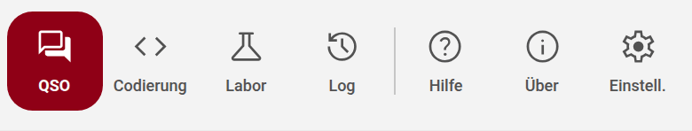

Ob hell oder dunkel, bestimmst du in den Einstellungen. Im Dunkeln leuchtet das Rot übrigens genauso wie im Hellen, das ist ausdrücklich so gewollt. Flächen und Text sind neutrales Grau, nur die Akzente sind rot.

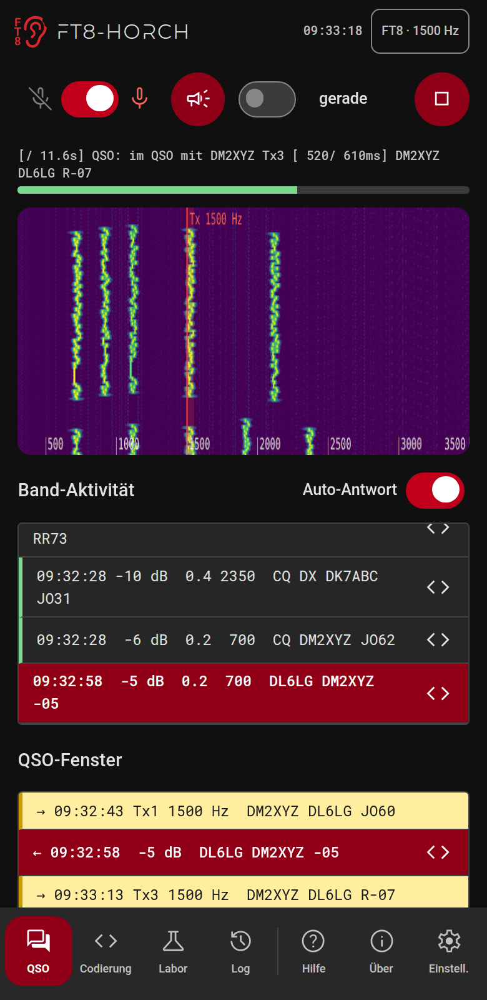

Auf breiten Bildschirmen (Tablet quer, PC) steht die Navigation links, und Band-Aktivität und QSO-Fenster liegen nebeneinander. Auf schmalen Handys ist alles etwas kleiner (90 Prozent), damit mehr auf den Bildschirm passt.

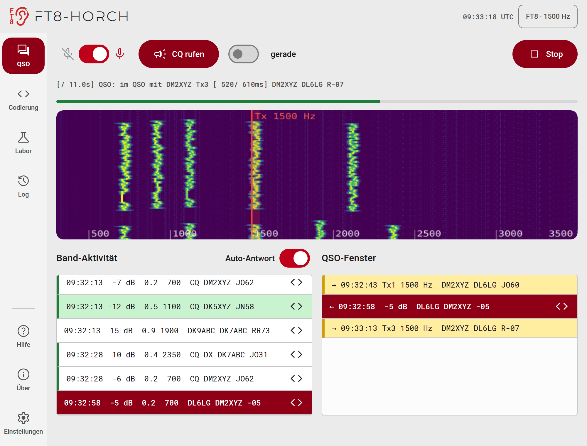

## Ein QSO fahren

### Mikrofon, Bedienleiste und Pegel

Im Reiter **QSO** schiebst du den **Mikrofon-Schalter** nach rechts. Der Browser fragt, ob die App das Mikrofon benutzen darf, und das muss sie, sonst hört sie nichts. Gleichzeitig bereitet die App die Tonausgabe vor, denn Browser spielen Töne nur ab, wenn man vorher irgendwo getippt hat.

Die App schaltet Echounterdrückung, Rauschunterdrückung und automatische Verstärkung des Geräts ab, soweit das Gerät es zulässt. Diese Helferlein sind für Telefonate gedacht und würden die FT8-Töne eher kaputtmachen. Außerdem hält sie den Bildschirm wach.

Die Bedienleiste oben im Reiter hat von links nach rechts: den **Mikrofon-Schalter** (links das durchgestrichene Mikrofon für „aus“, rechts das Mikrofon für „an“), den Knopf **CQ rufen**, einen Schalter für das **CQ-Fenster** (gerade oder ungerade) und ganz rechts den Knopf **Stop**. Mit dem Mikrofon-Schalter schaltest du das Mikrofon auch wieder aus. Dabei hält die App ein laufendes QSO an und gibt den Bildschirm frei. Solange das Mikrofon aus ist, sind **CQ rufen**, **Stop** und der Schalter **Auto-Antwort** ausgegraut. **Stop** ist außerdem nur aktiv, solange du CQ rufst oder ein QSO läuft.

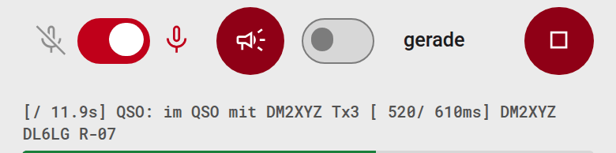

Die Statuszeile zeigt vorn in eckigen Klammern das laufende Zeitfenster und die Restzeit: ein senkrechter Strich `|` heißt gerades Fenster, ein Schrägstrich `/` ungerades Fenster, dahinter die Sekunden bis zum Ende, zum Beispiel `[/ 03.5s]`. Ist das Mikrofon an, folgen der Zustand („QSO: bereit“, „ruft CQ“ oder „im QSO mit DL1ABC Tx3“), die Rechenzeit des Decoders für den frühen und den späten Durchgang in Millisekunden (`[1234/2345ms]`) und, solange du sendest, die gesendete Nachricht. Ist das Mikrofon aus, steht dort „Mikrofon einschalten“. Darunter läuft ein dünner **Pegelbalken**. Er soll grün sein und sich bewegen, wenn Töne ankommen. Wird er rot, ist es zu laut und das Signal wird verzerrt. Wie du richtig einpegelst, steht weiter unten bei „Zwei Geräte, ein Tisch“.

### Wasserfall und Band-Aktivität

Der **Wasserfall** zeigt, was das Mikrofon hört: Die Frequenz läuft waagerecht von etwa 300 bis 3500 Hz, die Zeit senkrecht. Dunkelviolett ist Rauschen, Gelb und Grün sind Signale. Jeder FT8-Sender zieht eine wacklige Spur durchs Bild, so wie auf dem Bild unten.

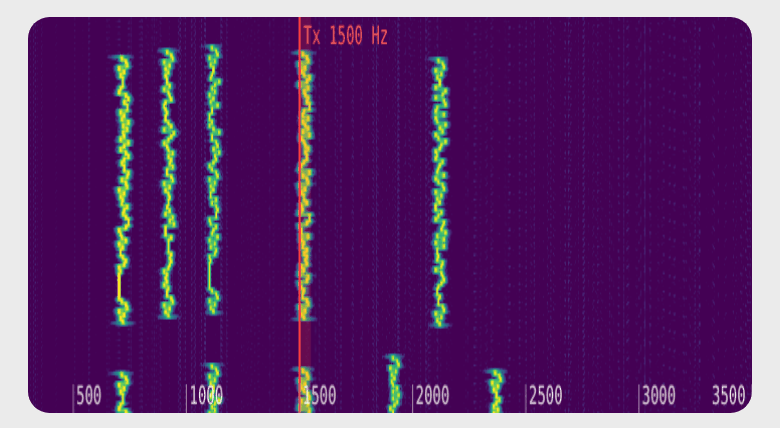

Die rote Linie mit der Beschriftung „Tx 1500 Hz“ ist die Frequenz, auf der **du** sendest. Wenn du doppelt in den Wasserfall tippst (zwei schnelle Tipper an derselben Stelle), wandert sie dorthin. Ein einzelner Tipp oder Wischen zum Scrollen ändert nichts. Praktisch, wenn du in einer Lücke zwischen zwei anderen Signalen senden willst.

Darunter stehen die Listen:

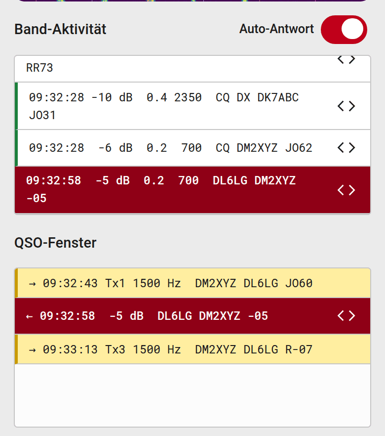

In der **Band-Aktivität** landet alles, was die App decodiert hat. Neue Zeilen kommen unten dazu, die älteren rutschen nach oben (wie in WSJT-X). Jede Zeile enthält die Uhrzeit des Fensters in UTC, den Rauschabstand in dB, den Zeitversatz DT in Sekunden, die Frequenz in Hz und schließlich die Nachricht. Zeilen mit grünem Rand sind CQ-Rufe, ein Tipp darauf antwortet. Steht am Ende einer Zeile „(spät)“, hat erst der späte Decodierdurchgang das Signal gefunden. Auf so ein CQ antwortet die Auto-Antwort nicht, denn die Antwort käme erst ein Fensterpaar (30 Sekunden) später. Per Tipp geht es trotzdem, die App schreibt dann ins QSO-Fenster, wann sie sendet. Die Farben der Zeilen (in der Band-Aktivität und im QSO-Fenster): **rot** ist, was an dich gerichtet ist, **gelb** ist, was du sendest, **weiß** (im Dunkeln dunkelgrau) ist, was dich nichts angeht, **hellgrün** sind Rufzeichen, mit denen du schon ein QSO im Log hast, und **hellgrau** sind Meldungen der App selbst.

Das kleine Symbol mit den spitzen Klammern rechts in einer Zeile öffnet den Reiter *Codierung* und zeigt dir, wie die App genau dieses Signal decodiert hat. Der Tipp auf die Zeile selbst antwortet weiter auf das CQ.

Im **QSO-Fenster** darunter stehen nur die Nachrichten, die dich betreffen: mit Pfeil nach rechts (→) das, was du sendest, mit Pfeil nach links (←) das, was bei dir ankommt.

### CQ rufen oder antworten

Du hast zwei Möglichkeiten.

**Du rufst CQ:** Tippe auf **CQ rufen**. Mit dem Schalter neben den Knöpfen (**gerade** oder **ungerade**) bestimmst du, ob du in den geraden oder in den ungeraden Fenstern sendest. Bei 15 Sekunden heißt das: gerade ist :00 und :30, ungerade ist :15 und :45. Die App wiederholt den CQ-Ruf, bis jemand antwortet oder du auf **Stop** tippst. Sie wiederholt ihn ohne Limit, sie ist da hartnäckig.

**Du antwortest:** Tippe in der Band-Aktivität auf einen CQ-Ruf. Die App stellt deine Sendefrequenz auf die Frequenz des Anrufers und sendet im jeweils anderen Fenster, so wie es sich gehört. Im QSO-Fenster steht dazu, wann es losgeht, zum Beispiel „Antwort an DM2XYZ (1730 Hz), sendet 18:15:45 (in 12 s)“.

**Die App antwortet von allein:** Über der Band-Aktivität sitzt der Schalter **Auto-Antwort**. Ist er an und läuft gerade kein QSO, antwortet die App auf das erste CQ, das der Decoder in einem Fenster findet. Das Antippen einer Zeile geht trotzdem weiter. Übersprungen werden dein eigenes Rufzeichen und gerichtete Rufe wie „CQ DX“ oder „CQ NA“. Ob auch Stationen übersprungen werden, die schon in deinem Log stehen, stellst du in den Einstellungen unter **Automatik** ein (von heute, aus dem ganzen Log oder keine). Dort legst du außerdem fest, ob die App beim Antworten die **Frequenz der Gegenstelle** übernimmt oder deine **eigene Frequenz hält**, und ob sie nach einem QSO aus deinem eigenen CQ **weiter CQ ruft** (nach 73, nach aufgegebenem Gespräch oder nach den RR73-Wiederholungen, im selben Fenster wie bisher). Stop beendet alles. Die Auto-Antwort löst nur nach dem frühen Decodierdurchgang aus, denn ein später gefundenes CQ erreicht das nächste Sendefenster nicht mehr. Der Schalter ist nach dem Start der App an. Du kannst ihn jederzeit ausschalten, dann antwortest du nur noch per Tipp. Wenn das QSO fertig ist, antwortet die App beim nächsten CQ gleich wieder. Antwortet sie auf ein CQ nicht, sagt sie dir im QSO-Fenster warum: „Auto-Antwort: CQ nicht beantwortet, …“ (ein QSO läuft noch) oder „CQ erst im späten Durchgang gefunden“.

Es sendet immer nur einer von euch beiden zur selben Zeit: Wer im geraden Fenster ruft, wird im ungeraden Fenster beantwortet. Das ist die ganze Magie, die verhindert, dass beide gleichzeitig reden.

### Was im QSO passiert

Die App folgt der Auto-Sequenz von WSJT-X. Die Nachrichten heißen `Tx1` bis `Tx6`:

| Nachricht | Inhalt | Beispiel |
| --- | --- | --- |
| Tx1 | Antwort auf CQ, mit Locator | `DL1ABC DL6LG JO60` |
| Tx2 | Rapport senden | `DL1ABC DL6LG -07` |
| Tx3 | Rapport bestätigen, eigenen senden | `DL1ABC DL6LG R-07` |
| Tx4 | Bestätigung | `DL1ABC DL6LG RR73` |
| Tx5 | Schlussgruß | `DL1ABC DL6LG 73` |
| Tx6 | allgemeiner Anruf | `CQ DL6LG JO60` |

Rufst du CQ, läuft es so: Du sendest Tx6, jemand antwortet mit Tx1, du schickst Tx2, bekommst Tx3 zurück, bestätigst mit Tx4 und das 73 der Gegenseite macht das QSO rund. Antwortest du selbst, bist du bei Tx1, Tx3 und Tx5 dran. Den Rapport berechnet die App aus dem gemessenen Rauschabstand der Gegenstelle, gerundet auf ganze dB und begrenzt auf −30 bis +32.

Die Statuszeile über dem Pegelbalken sagt dir, wo du gerade stehst: „QSO: im QSO mit DL1ABC Tx3“ heißt, du bist im QSO mit DL1ABC und als Nächstes kommt Tx3. Das Fenster, in dem du sendest, ist das Gegenteil des Fensters der Gegenstation.

Wenn die Gegenstelle nicht antwortet, wiederholt die App die Nachricht bis zu fünfmal. Das RR73 sendet sie bis zu dreimal, wenn das 73 ausbleibt. Danach gibt sie auf, bei RR73 mit dem Vermerk „unbestätigt“. Nach einem abgeschlossenen QSO sendet die App von sich aus nichts mehr. Sie ruft nicht heimlich weiter CQ, nur weil dir langweilig ist. Es sei denn, du hast in den Einstellungen unter **Automatik** „weiter CQ rufen“ gewählt, dann beginnt sie nach einem QSO aus deinem eigenen CQ wieder von vorn.

Das QSO landet automatisch im **Log**, bestätigt oder unbestätigt. Mit **Stop** (ganz rechts, nur aktiv, solange du CQ rufst oder ein QSO läuft) stoppst du die Sendung und das QSO jederzeit.

Zur Technik dahinter: Die App decodiert jedes Fenster zweimal, einmal früh (nach rund 13,7 Sekunden) und einmal am Ende (nach 15,05 Sekunden). Welche Nachricht sie als Nächstes sendet, entscheidet sie 0,4 Sekunden vor dem Sendefenster. In der Statuszeile steht hinterher, wie lange beide Durchgänge zuletzt gebraucht haben (`[ 520/ 610ms]`). Der späte Durchgang hält die Sendung nicht auf. Wird der frühe Durchgang erst mehr als eine Sekunde nach Fensterbeginn fertig, verpasst die Antwort ihr Fenster und geht 30 Sekunden später raus. In meinen Tests brauchte der Decoder auf dem Pixel 10a etwa 1,0 bis 1,3 Sekunden, auf dem alten Tablet 0,9 bis 1,5 Sekunden und am PC deutlich weniger. Das reicht, wenn nicht gleichzeitig noch ein zweiter Durchgang die Rechenzeit teilt.

## Profil: Zeit und Tonabstand

Ein Tipp auf den Profil-Chip in der Kopfzeile öffnet die Profil-Einstellungen. Dort stellst du ein:

* **Sendefrequenz:** einstellbar zwischen 200 und 3000 Hz, sinnvoll sind 500 bis 2700 Hz, vorgegeben sind 1500 Hz. Sie steht oben im Dialog.
* **Zeit:** 15, 30, 60 oder 120 Sekunden je Fenster. Das ist der Zeitfaktor.
* **Tonabstand:** von 6,25 bis 100 Hz.

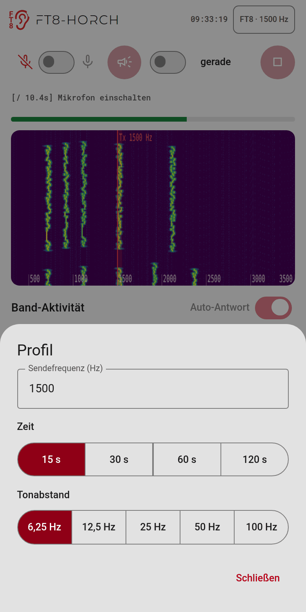

15 Sekunden mit 6,25 Hz Tonabstand ist echtes FT8, so wie WSJT-X es kennt. Alles andere ist eine **FT8-Variante**. Die App nennt sie ausdrücklich nicht „FT8“, denn ein anderes Gerät mit WSJT-X versteht sie nicht. Mit zwei Geräten, die beide FT8-Horch benutzen, klappt es aber, solange auf beiden Seiten **dasselbe Profil** eingestellt ist. Während ein QSO oder der Verbindungstest läuft, lassen sich Zeit und Tonabstand nicht ändern, die App meldet dann „erst Stop drücken“. Die Sendefrequenz dagegen darfst du jederzeit verschieben.

Wozu das Ganze? Wer die Zeit verdoppelt, bekommt etwa 2,5 bis 3 dB mehr Empfindlichkeit, das Signal darf also tiefer im Rauschen versinken. Mit 120 Sekunden sind das über 8 dB. Dafür dauert ein QSO entsprechend länger. Ob man das braucht, wenn die zwei Handys auf dem Tisch nebeneinanderliegen, ist eine andere Frage. Aber man kann es.

Die App warnt dich bei Einstellungen, die Ärger machen: Unter 500 Hz gibt ein Handylautsprecher kaum etwas ab, über 2700 Hz beschneidet ein Funkgerät, und wenn das Sendeband über 5,5 kHz hinausreicht, passt es nicht mehr in die Abtastung.

## Zwei Geräte, ein Tisch

Der Normalfall dieser App: Gerät A ruft, Gerät B antwortet, und die beiden unterhalten sich zwitschernd über Lautsprecher und Mikrofon. Dein Nachbar wird fragen, ob das ein neuer Vogel ist. Du kannst ihm sagen, dass das Mathematik ist.

Ein paar Erfahrungen aus meinen Tests:

* **Erst nah, dann weiter.** Leg die Geräte anfangs eine Handbreit auseinander. In einem ruhigen Raum hatte ich einen Rauschabstand von 41 bis 56 dB, FT8 braucht nur etwa −21 dB. Es ist also reichlich Luft nach oben.
* **Leise reicht.** Stell die Lautstärke des sendenden Geräts auf mittel und beobachte den Pegelbalken des hörenden. Er soll grün bleiben. Rot heißt Übersteuerung, und das ist zu laut.
* **Nicht zu tief senden.** Die Lautsprecher von Handys geben tiefe Töne schwach wieder, bei 500 Hz fehlten in meiner Messung 26 dB gegenüber 1500 Hz. Auch sonst ist der Frequenzgang holprig. Bei 1500 Hz fühlt sich alles wohl, deshalb ist das die Vorgabe.
* **Keine Kopfhörer am sendenden Gerät.** Klingt banal, aber ein angesteckter Kopfhörer leitet den Ton am Lautsprecher vorbei.
* **Gleiche Einstellungen.** Beide Geräte brauchen dasselbe Profil und die richtige Uhrzeit.
* **Verbindung prüfen.** Wenn du wissen willst, ob zwei Geräte zusammenpassen, nimm den **Verbindungstest** im Labor. Er zeigt für beide Richtungen Rauschabstand und DT.
* **Jedes Gerät pegelt anders.** In meinen Messungen lagen die Aufnahmepegel von Pixel und Tablet rund 12 dB auseinander. Das ist kein Fehler, nur ein Grund, den Pegeltest im Labor zu benutzen.

## Labor

Im Reiter **Labor** liegt die Werkstatt. Hier misst du, ob Mikrofon und Lautsprecher mitspielen, testest zwei Geräte gegeneinander, arbeitest mit WAV-Dateien und probierst aus, wie viel Rauschen der Decoder verträgt. Die Karten heißen Pegeltest, Laufzeitmessung, Verbindungstest, WAV-Dateien und Simulator. Alle Messungen laufen nur, wenn gerade kein QSO läuft (sonst bittet dich die App, zuerst auf **Stop** zu tippen).

### Pegeltest

Die App nimmt zwei Sekunden Stille auf, spielt dann drei Sekunden lang einen Testton von 1500 Hz und hört ihn mit dem eigenen Mikrofon wieder ab. Aus beidem berechnet sie den Rauschboden, den Pegel des Tons, die Spitze und den Abstand zum Rauschen (bezogen auf 2500 Hz Bandbreite).

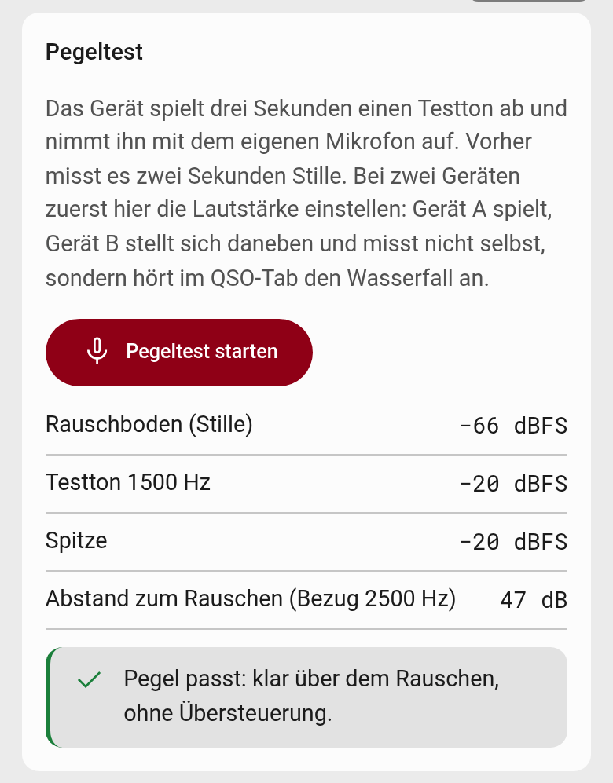

Am Ende steht ein Urteil: *passt* ist alles, was klar über dem Rauschen liegt, ohne zu übersteuern. *Etwas hoch* heißt, die Spitze liegt über −6 dBFS, die Lautstärke darf etwas runter. *Übersteuert* ist zu laut. *Zu leise* heißt, der Abstand zum Rauschen liegt unter 30 dB. *Kein Ton* bedeutet, dass die App ihren eigenen Ton nicht gehört hat, vielleicht wegen Kopfhörern oder weil die Lautstärke auf null steht.

### Laufzeitmessung

Das ist die Messung für alle, die wissen wollen, warum ihre Geräte sich bei DT nicht einig sind. Die App schickt fünfmal einen kurzen Zwitscherton (einen Chirp, 0,3 Sekunden von 600 bis 2400 Hz) über den eigenen Lautsprecher zum eigenen Mikrofon und misst, wie weit die Aufnahmezeit von der geplanten Sendezeit abweicht.

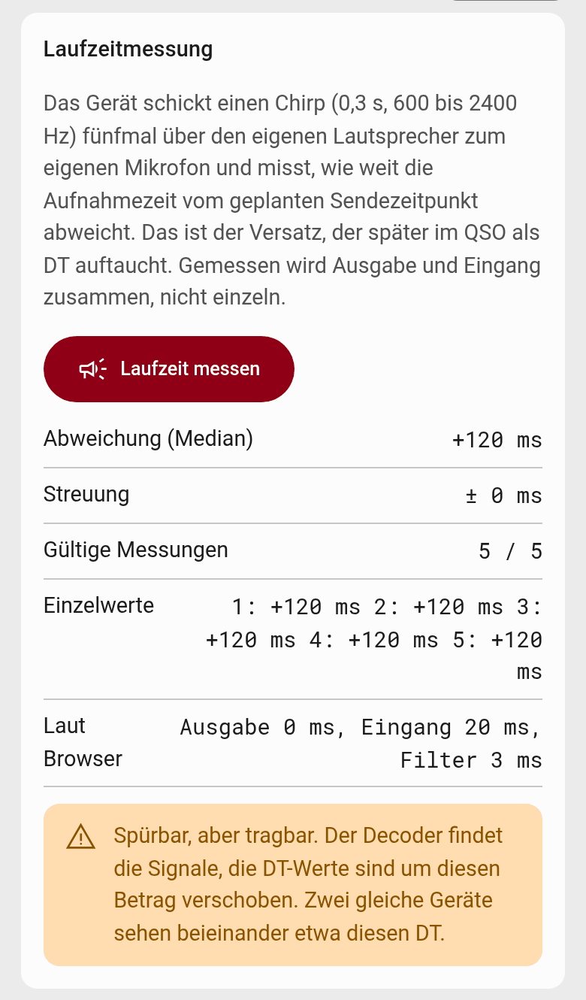

Du bekommst den Median, die Streuung, die Zahl der gültigen Messungen und alle Einzelwerte. Dazu steht, was der Browser über seine eigenen Latenzen weiß. Das Ergebnis ist die Summe aus Ausgabe und Eingang, genau das, was später bei zwei gleichen Geräten als DT auftaucht. Unter 0,1 Sekunden ist es unkritisch, bis 0,5 Sekunden tragbar, darüber wird es zu viel.

### Verbindungstest mit einem zweiten Gerät

Der Test ersetzt das Probieren von Hand, wenn du zwei Geräte nebeneinander legst. Er misst für beide Richtungen, wie gut die Verbindung über Lautsprecher und Mikrofon ist, und er trennt den Uhrunterschied von der Latenz.

**Vorbereitung:** Beide Geräte haben Rufzeichen und Locator eingetragen, das Mikrofon an, dasselbe Profil (Zeit und Tonabstand) und genug Lautstärke. Es läuft kein QSO.

1. Auf dem einen Gerät wählst du unter **Verbindungstest** „Gerät A“, auf dem anderen „Gerät B“. Die Zahl der **Runden** (2 bis 10, Vorgabe 4) muss auf beiden gleich sein.
2. Tippe auf **Test starten**, auf beiden Geräten innerhalb von wenigen Sekunden. Die App nennt die **Startzeit in UTC**. Die muss auf beiden Geräten gleich sein. Steht auf den Geräten eine andere Zeit, tippst du auf **Test abbrechen** und startest neu.
3. A sendet in den geraden Fenstern, B in den ungeraden einen Kurztext (`HORCH A 01`). Jedes Gerät misst, wie es den anderen hört. Nach den Runden folgt ein Paar Pause und danach ein Paar, in dem jedes Gerät seine Zusammenfassung schickt: wie viele Nachrichten es gehört hat, mit welchem Rauschabstand und welchem DT.

Bei 15-Sekunden-Fenstern dauert der Test (2 · Runden + 4) · 15 Sekunden, mit 4 Runden also zwei Minuten. Währenddessen sind CQ, Antworten und die Auto-Antwort gesperrt, die Station decodiert aber weiter.

**Ergebnis**, auf beiden Geräten gleich:

* **Von Gerät B empfangen:** wie viele der Runden dieses Gerät gehört hat, mittlerer Rauschabstand, mittleres DT und dessen Streuung.
* **Gerät B hört dieses Gerät:** dasselbe aus der Zusammenfassung der Gegenseite.
* **Mittleres DT beider Richtungen:** Die Uhren heben sich heraus, es bleiben die Latenzen der beiden Geräte (Wiedergabe und Aufnahme). Liegt es über 0,3 Sekunden, ist die Verbindung für FT8 zu träge (siehe Laufzeitmessung).
* **Uhr dieses Geräts gegenüber dem anderen:** der Unterschied der beiden Uhren, mit Vorzeichen. Plus heißt, die eigene Uhr geht vor. Er enthält auch den Unterschied der Latenzen, ist also genau genommen eine Obergrenze für den Uhrfehler.

Dazu kommen Befunde in Klartext: Gut (beide Richtungen kommen an, DT und Uhrunterschied unter 0,3 Sekunden), nichts gehört, weniger als drei von vier Nachrichten decodiert, Latenz zu hoch, Uhren verschieden oder Zusammenfassung nicht angekommen. Mit **Ergebnis als Text speichern** legst du die Zahlen als Datei ab, zum Beispiel für das Protokoll deiner Tests.

Kommt die Zusammenfassung der Gegenseite nicht an (zum Beispiel, weil es dort gerade zu laut war), zeigt dein Gerät nur seine eigene Richtung. Die andere steht dann auf dem anderen Gerät.

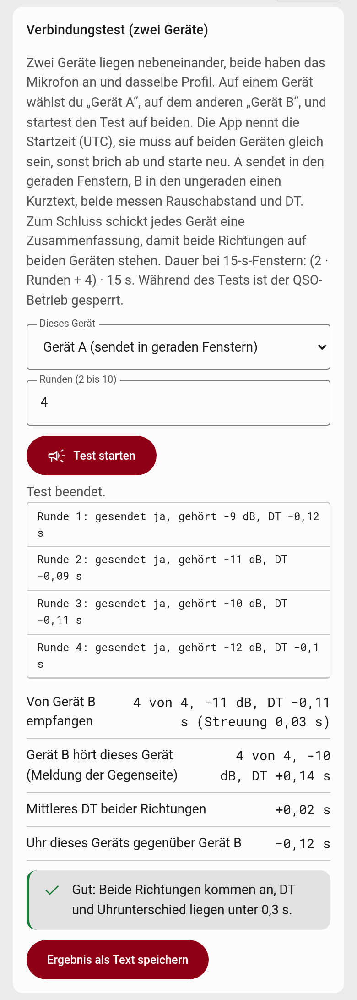

### WAV-Dateien

Hier geht es um Dateien statt Luft:

* **Letztes Fenster speichern** legt die Aufnahme des letzten vollständigen Fensters als WAV ab (12 kHz, 16 Bit, mono). Das Mikrofon muss dafür laufen. Die Datei beginnt 2,5 Sekunden mal kt vor dem Fenster, damit auch Signale mit negativem DT vollständig sind. Zeitfaktor, Tonabstandfaktor und dieser Vorlauf stehen im Dateinamen (`ft8-horch_aufnahme_20261021_080000_kt1_kf1_vorlauf2.5s.wav`).
* **WAV laden und decodieren** liest eine Datei und zeigt, was der Decoder darin findet, mit Rauschabstand, DT, Frequenz und Text. Bei einer Aufnahme aus FT8-Horch übernimmt die App kt, kf und Vorlauf aus dem Dateinamen. Bei Dateien von WSJT-X oder anderswo gilt das aktuelle Profil und der Vorlauf, den du im Feld einträgst (bei WSJT-X: 0). Mono und Stereo, 8 bis 32 Bit und andere Abtastraten sind kein Problem, die App rechnet auf 12 kHz um. Die Datei darf höchstens vier Fenster lang sein. Bei längeren Aufnahmen schneide vorher ab. Das Decodieren kann auf einem Handy ein paar Sekunden dauern. Mit dem Symbol rechts in der Zeile siehst du, wie das Signal im Codierungs-Tab entschlüsselt wurde.

Das hilft bei der Fehlersuche (eine Aufnahme, bei der etwas schiefging, lässt sich später in Ruhe ansehen) und beim Vergleich mit WSJT-X.

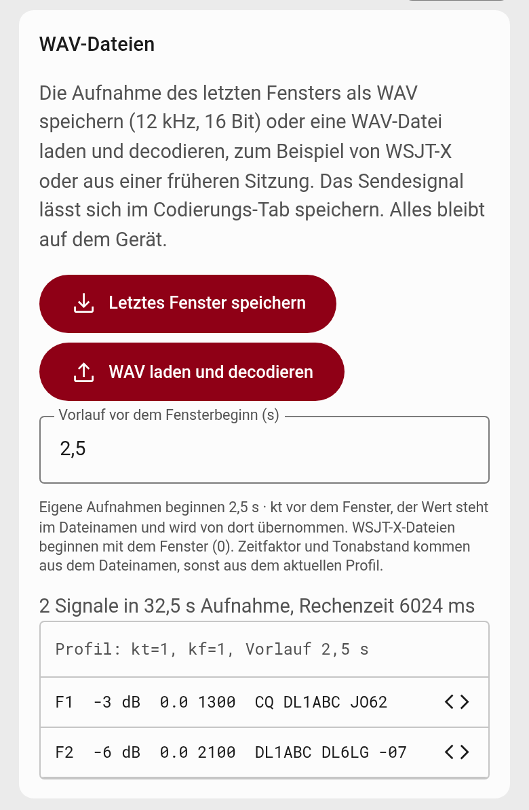

### Simulator

Der Simulator erzeugt ein Signal im Gerät, mischt Rauschen, Zeitversatz, Frequenzversatz und Taktfehler dazu und lässt den echten Decoder darauf los. Ohne Lautsprecher, ohne Mikrofon, ohne Nachbarn.

Der **Einzelversuch** zeigt dir, ob und wie die Nachricht decodiert wurde, dazu DT, Frequenz, geschätzten Rauschabstand und Rechenzeit.

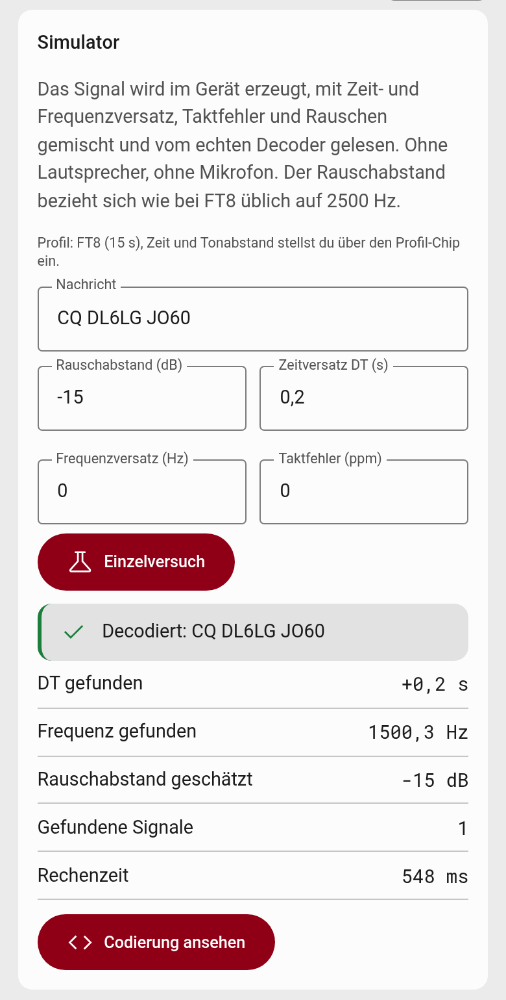

Mit dem Knopf **Codierung ansehen** unter dem Ergebnis springst du in den Reiter *Codierung* und siehst, wie der Decoder sich durch das Signal gearbeitet hat.

Die **Reihe** läuft über mehrere Rauschabstände und mehrere Versuche je Wert. Du bekommst eine Kurve der Erfolgsrate, die 50-Prozent-Schwelle und, wenn du alle vier Zeitfaktoren wählst, den Gewinn je Verdopplung der Zeit. Eine Reihe kann dauern, vor dem Start steht eine grobe Schätzung, und mit **Abbrechen** hörst du jederzeit auf.

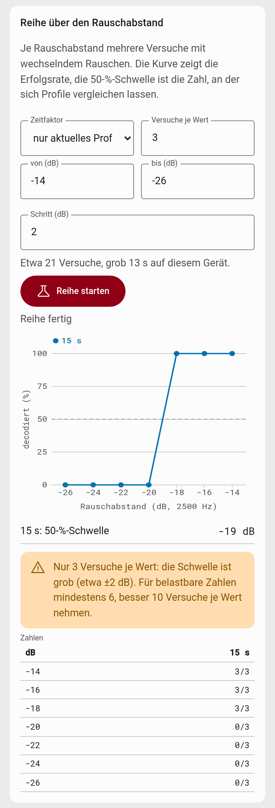

Ein ehrlicher Hinweis steht auch in der App: Bei weniger als sechs Versuchen je Wert ist die Schwelle nur grob, die Kurve zackt dann ordentlich. Zehn Versuche je Wert sind besser. Bei meinem Test mit einem einzigen Versuch je Wert kamen 1,7 dB je Verdopplung heraus, wo es 2,5 bis 3 sein sollten. Das war keine neue Physik, das war Zufall.

## Codierung

Der Reiter **Codierung** ist der Ort für alle, die mit mir schon bei dem kleinen Skript angefangen haben. Oben schaltest du zwischen **Senden** und **Empfangen** um. Jede Karte ist aufklappbar und hat unter dem Einleitungssatz ein „Mehr dazu“ mit einer ausführlichen Erklärung. Die ist ziemlich ausführlich, ich konnte mich nicht bremsen.

### Senden: von der Nachricht zum Signal

Tippe eine Nachricht ein, etwa `CQ DL6LG JO60`, und die App zeigt dir acht Karten:

1. die **Felder** der Nachricht (Rufzeichen, Locator und ein paar Kennbits),
2. die **77 Bits**, aufgeteilt nach Feldern,
3. die **CRC-14**, eine Prüfsumme, die 14 Bits anhängt,
4. den **LDPC-Code**, der aus 91 Bits die 174 Bits des Codeworts macht,
5. den **Fehlerschutz zum Ausprobieren** (dazu gleich mehr),
6. die **Dreiergruppen** und ihre Töne,
7. die **79 Symbole** mit den drei Costas-Blöcken,
8. das **Signal** als Spektrogramm, das du dir mit „Abspielen“ auch anhören kannst. Mit „Als WAV speichern“ bekommst du das ganze Fenster als Datei (12 kHz, 16 Bit, mono, Beginn 0,5 s nach dem Fensteranfang). Die kannst du in WSJT-X öffnen und prüfen, ob es das Signal versteht. Der Dateiname nennt Text, Frequenz, kt und kf.

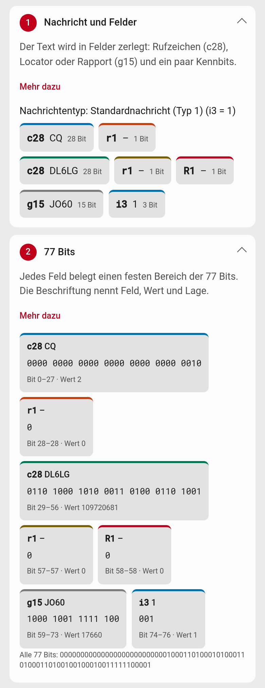

Nachrichten, die die App nicht packen kann (Rufzeichen mit `/P`, Hash-Rufzeichen, Freitext mit mehr als 13 Zeichen), meldet sie mit einem verständlichen Hinweis, statt einfach nichts zu tun.

### Fehlerschutz zum Ausprobieren

Das ist mein Lieblingsspielzeug. In der fünften Karte siehst du alle 174 Bits des Codeworts. Tippe auf einzelne Bits, um sie zu kippen, oder lass die App zufällige Fehler einbauen. Darunter siehst du, wie viele Prüfgleichungen verletzt sind, wie viele Durchläufe der Decoder braucht und ob er den Fehler wieder wegbekommt.

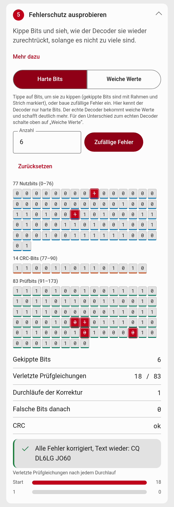

Gekippte Bits sind mit Rahmen und Strich markiert, damit man sie auch ohne Farbensinn findet. Zum Gefühl für die Größenordnung: Bis vier gekippte Bits korrigiert der Decoder immer, bei zehn in etwa 95 von 100 Fällen, bei fünfzehn nur noch in etwa jedem neunten, ab zwanzig gar nicht mehr. Das gilt für diese Lehrdarstellung mit harten Bits. Der echte Decoder bekommt mehr Information und schafft deutlich mehr.

Wie viel mehr, zeigt der Schalter **Weiche Werte** über dem Raster. Die App simuliert dann einen Funkkanal mit einstellbarem Rauschabstand und gibt dieselbe Störung zwei Decodern: einem, der nur die harten Bits kennt (Bit ist 0 oder 1), und einem, der zu jedem Bit auch die Sicherheit bekommt. Im Raster sind die Bits, die das Rauschen falsch gemacht hat, gerahmt. Mit „100 Versuche zählen“ siehst du die Erfolgsrate. Bei −19 dB (Standardprofil) schafft der weiche Decoder grob neun von zehn Versuchen, der harte etwa jeden dritten. Die Zahlen stammen aus einem vereinfachten Kanalmodell (nur Rauschen, keine Schwund- und Laufzeiteffekte), ein echter Funkweg ist unfreundlicher. Bei gedehnter Zeit ist das Modell zu optimistisch: Bei kt = 8 sagt es eine Schwelle von etwa −29 dB voraus, der echte Decoder schaffte in der Messung −27,3 dB.

### Empfangen: vom Signal zur Nachricht

Der Reiter **Empfangen** zeigt, wie die App ein decodiertes Signal gefunden und gelesen hat. Du kommst dorthin über das Symbol mit den spitzen Klammern an einer Zeile der Band-Aktivität oder nach einem Einzelversuch im Simulator.

Fünf Karten erzählen die Geschichte: **Signal gefunden** (Zeit, Frequenz, Rauschabstand), **Tonleistungen** (die Leistung aller acht Töne in jedem der 79 Symbole), **LLR** (für jedes der 174 Bits ein weicher Wert, wie sicher die App sich ist), **Belief Propagation** (die Prüfgleichungen verhandeln, bis alle aufgehen) und **CRC und Text** (Prüfsumme gegengerechnet, Nachricht gelesen).

, vom Decoder gelesen.")

Bei schwachen Signalen sieht man die Fehler, die das Rauschen eingebaut hat, und wie die Fehlerkorrektur sie wieder ausbügelt. In einem meiner Versuche bei −18 dB hatten nur 72 von 79 Symbolen den richtigen stärksten Ton, die Korrektur hat acht Bits gedreht, und am Ende stand trotzdem die richtige Nachricht da.

## Log und Protokoll

Im Reiter **Log** gibt es zwei Ansichten: die abgeschlossenen QSOs und das Textprotokoll.

Unter **QSOs** steht jedes abgeschlossene QSO mit Uhrzeit, Rufzeichen, Locator und den beiden Rapporten. Ein QSO ohne das abschließende 73 ist als „unbestätigt“ markiert. Du kannst nach Rufzeichen, Locator und Notiz suchen, nach bestätigt oder unbestätigt filtern und den Zeitraum eingrenzen. Die beiden Datumsfelder sind schon mit deinem ersten und letzten Eintrag vorbelegt, ohne Eintrag steht dort das heutige Datum.

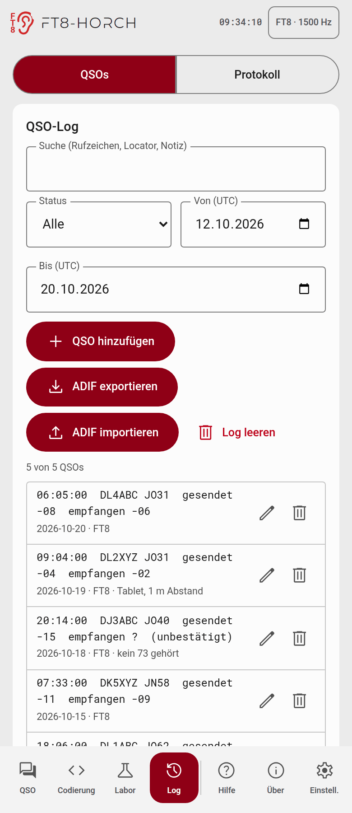

Mit **QSO hinzufügen** trägst du ein QSO von Hand ein, zum Beispiel eines, das du mit WSJT-X gefahren hast oder das bei einem Absturz nicht im Log gelandet ist. Du gibst Datum, Beginn und Ende (UTC), Rufzeichen und, wenn du sie kennst, Locator, Rapporte und Notiz an. Fehlt das Ende, nimmt die App zwei Minuten nach dem Beginn. Solche Einträge tragen den Vermerk „von Hand“, und die ADIF-Datei erwähnt es im Kommentar.

Mit dem Stift öffnest du einen Eintrag zum Bearbeiten (Rufzeichen, Locator, Rapporte, bestätigt oder nicht, eine Notiz), mit dem Papierkorb löschst du ihn nach einer Rückfrage.

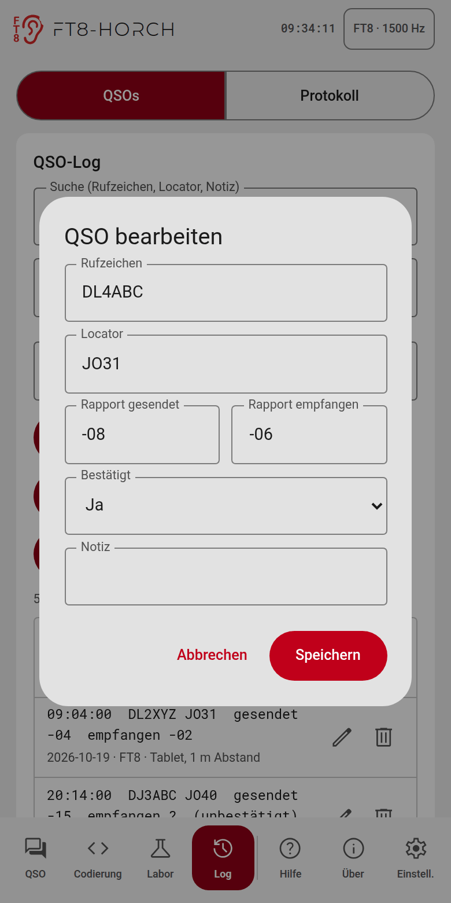

**ADIF exportieren** schreibt alle QSOs in eine Datei `ft8-horch_<Datum>.adi`, die du in andere Logbuch-Programme laden kannst. Weil das QSO über Lautsprecher stattfand und nicht über ein Band, enthält die Datei weder Frequenz noch Band (außer bei Einträgen, die du aus einer ADIF-Datei importiert hast). Echtes FT8 steht als `FT8` darin, jede Variante als `MFSK` mit Hinweis im Kommentar. Ob dein Logbuch-Programm damit zurechtkommt, habe ich noch nicht überprüft.

**ADIF importieren** liest eine ADIF-Datei ein, zum Beispiel das Log von WSJT-X (`wsjtx_log.adi`) oder eine frühere Datei aus FT8-Horch. Übernommen werden nur FT8-QSOs (und FT8-Varianten von FT8-Horch mit ihrem Profil), andere Betriebsarten zählt die App und lässt sie weg. Band und Frequenz bleiben erhalten und stehen beim nächsten Export wieder in der Datei. Ein QSO mit derselben Gegenstelle und einem Beginn höchstens zwei Minuten neben einem vorhandenen gilt als Dublette und wird nicht noch einmal angelegt. Importierte Einträge tragen den Vermerk „importiert“. Unter der Schaltfläche steht, wie viele QSOs übernommen wurden und wie viele nicht.

Das **Protokoll** ist die Liste aller Decodierungen und Sendungen mit Zeit, Rapport, DT, Frequenz und Text, so wie man es von WSJT-X kennt. Du kannst nach Empfang, Gesendet und „Mein QSO“ filtern, im Text suchen und das Ganze als Text- oder CSV-Datei exportieren. Gespeichert werden die letzten 5000 Zeilen. Weil dort auch die Rufzeichen anderer Stationen stehen, bleibt das Protokoll auf deinem Gerät, bis du es selbst exportierst.

Die App durchsucht das Protokoll außerdem nach Gesprächen, die nicht im Log stehen (zum Beispiel, weil die Gegenstelle das 73 nie geschickt hat). Findet sie welche, erscheint oben im Protokoll eine Karte „QSOs im Protokoll gefunden“. Mit dem Plus übernimmst du ein Gespräch: Rufzeichen, Locator, Rapporte und Zeiten sind schon eingetragen, du kontrollierst sie und speicherst. Als gefunden gilt ein Gespräch, wenn du und die Gegenstelle je mindestens eine Nachricht gesendet haben. Pausen von mehr als fünf Minuten trennen zwei Gespräche. Als bestätigt gilt es nur, wenn die Gegenstelle RR73, RRR oder 73 gesendet hat.

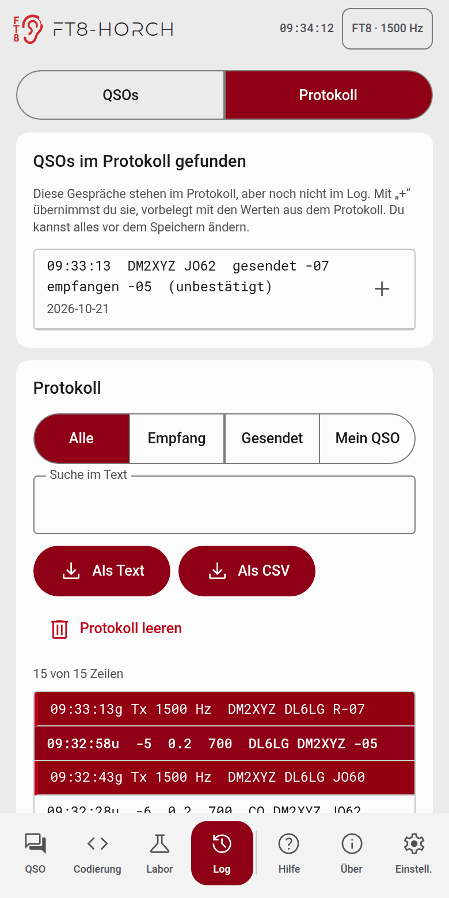

## Wenn nichts geht

Ein kleiner Katalog der üblichen Verdächtigen.

**Das Mikrofon geht nicht an.** Der Browser hat die Erlaubnis verweigert oder noch nicht gefragt. Schau in den Einstellungen der Webseite im Browser nach, ob das Mikrofon erlaubt ist. Außerdem verlangt der Browser für das Mikrofon eine sichere Verbindung (https) oder `localhost`.

**Der Wasserfall bleibt schwarz.** Läuft das Mikrofon (Schalter oben links nach rechts geschoben, in der Statuszeile steht dann „QSO: bereit“)? Bewegt sich der Pegelbalken? Manchmal hat eine andere App das Mikrofon belegt.

**Es kommt nichts an.** Lautstärke und Abstand prüfen, den Pegeltest im Labor machen, nachsehen, ob Kopfhörer stecken. In lauter Umgebung hilft es, näher heranzugehen.

**Es kommt etwas an, wird aber nicht decodiert.** Dann ist meistens die Uhr schuld oder das Profil. Beide Geräte brauchen die gleichen Einstellungen und die richtige Zeit. Schau im Protokoll nach, wie groß DT in den Zeilen ist. Liegt es dauerhaft bei einer Sekunde oder mehr, stimmt etwas mit der Uhr oder der Laufzeit nicht, dann hilft die Zeitprüfung und die Laufzeitmessung.

**Die App antwortet nicht auf ein CQ.** Schau ins QSO-Fenster: Steht dort „Auto-Antwort: CQ nicht beantwortet, …“, läuft noch ein QSO. Steht dort „CQ erst im späten Durchgang gefunden“ oder hat die Zeile den Zusatz „(spät)“, war das Signal zu spät dran. Dann hilft ein Tipp auf die Zeile. Prüfe außerdem, ob das Mikrofon an ist (die Schalter **CQ rufen** und **Auto-Antwort** sind sonst ausgegraut) und ob das Rufzeichen des Anrufers nicht deinem eigenen entspricht.

**Die Antwort kommt 30 Sekunden zu spät.** Die App sendet nur, wenn der frühe Decodierdurchgang höchstens eine Sekunde nach Fensterbeginn fertig ist. Sieh in der Statuszeile nach, wie lange er braucht (`[ 520/ 610ms]`), und nach DT im Protokoll. Ist DT groß, kommt das Signal zu spät an, dann hilft die Laufzeitmessung im Labor.

**Das QSO bricht ab.** Hat die Gegenstelle dasselbe Profil? Sendet ihr im richtigen Fenster? Der Anrufer sendet im gewählten Fenster, der Antwortende automatisch im anderen. Zeigt der Decoder lange Rechenzeiten, kann die Antwort ein Fenster zu spät kommen.

**Die App zeigt eine alte Version.** Unter **Über** steht in der Zeile **Dateien (Cache)**, welche Fassung geladen ist. Ist es nicht die erwartete, die Seite im Browser neu laden (nötigenfalls zweimal). Bei laufendem Mikrofon oder QSO lädt die App nicht selbst neu, dann kommt nur ein Hinweis.

**Der Verbindungstest startet nicht oder die Zeiten passen nicht.** Rufzeichen und Locator müssen eingetragen sein (sonst läuft die Station nicht), das Mikrofon muss laufen und es darf kein QSO laufen. Die Startzeit (UTC) muss auf beiden Geräten dieselbe sein. Weicht sie ab, tippe auf beiden Geräten auf **Test abbrechen** und starte noch einmal, diesmal möglichst gleichzeitig. Beide Geräte brauchen außerdem dieselbe Zahl Runden und dasselbe Profil.

**WAV laden meldet „zu lang“.** Die Datei darf höchstens vier Fenster lang sein (bei 15-Sekunden-Fenstern gut eine Minute). Schneide sie vorher zurecht.

**Sicherung einlesen geht nicht.** Die Datei muss von FT8-Horch stammen (Endung `.json`), und die App, die sie liest, darf nicht älter sein als die, die sie geschrieben hat. Unbrauchbare Einträge überspringt die App und zählt sie.

**Der Standort geht nicht.** Der Browser hat die Erlaubnis nicht erteilt, oder das Gerät findet kein Signal. Den Locator kannst du jederzeit von Hand eintragen.

**„Rufzeichen oder Locator ungültig“.** Rufzeichen brauchen mindestens drei Zeichen aus Buchstaben, Ziffern und dem Schrägstrich, Locatoren haben vier Zeichen im Muster Buchstabe (A bis R), Buchstabe (A bis R), Ziffer, Ziffer (zum Beispiel `JO60`).

## Kleines FT8-Wörterbuch

Für alle, die nur zufällig hier gelandet sind.

| Begriff | Bedeutung |
| --- | --- |
| CQ | „Hallo, ist da jemand?“ Der allgemeine Anruf. |
| QSO | Eine Funkverbindung, hier eine Folge von fünf bis sechs Nachrichten. |
| UTC | Weltzeit. Alle FT8-Uhren laufen nach UTC. |
| Fenster (Slot) | Ein 15-Sekunden-Abschnitt. Gerade Fenster beginnen bei :00 und :30, ungerade bei :15 und :45. |
| Locator | Ein Planquadrat auf der Erde, vier Zeichen wie `JO60` (Maidenhead-System). |
| Rapport | Der Signalpegel der Gegenstelle in dB, etwa `-07`. Mit „R“ davor: bestätigt. |
| SNR | Rauschabstand. Wie weit das Signal über dem Rauschen liegt, bezogen auf 2500 Hz Bandbreite. |
| DT | Der Zeitversatz zwischen Signal und erwartetem Start, in Sekunden. |
| f0 | Die Frequenz des tiefsten der acht Töne. |
| Profil | Zeit und Tonabstand. 15 s und 6,25 Hz sind Standard-FT8, alles andere eine Variante. |
| Durchgang | Ein Decodierlauf. Die App decodiert jedes Fenster zweimal: früh (13,7 s) und am Ende (15,05 s). |
| Auto-Antwort | Die App antwortet von allein auf das erste CQ, solange kein QSO läuft. |
| Costas-Muster | Sieben Töne in fester Folge, die dreimal im Signal vorkommen, damit der Empfänger Zeit und Frequenz findet. |
| CRC | Eine Prüfsumme, die falsche Nachrichten abfängt. |
| LDPC | Der Fehlerschutz, der aus 91 Bits 174 macht. |
| LLR | Ein weicher Wert pro Bit: wie sicher der Empfänger ist, ob es eine 0 oder eine 1 war. |
| RR73, 73 | Bestätigung und Schlussgruß. 73 heißt „beste Grüße“. |
| ADIF | Ein Austauschformat für Logbücher. |
| Verbindungstest | Zwei Geräte senden sich abwechselnd einen Kurztext und messen, wie gut sie sich hören. Gerät A sendet in geraden, Gerät B in ungeraden Fenstern. |
| WAV | Eine Audiodatei. FT8-Horch speichert und liest sie mit 12 kHz, 16 Bit, mono (andere Formate rechnet die App um). |

## Lizenz, Datenschutz und Danksagung

Unter **Über** findest du Version, Lizenz, Autor und Danksagungen noch einmal an einem Ort.

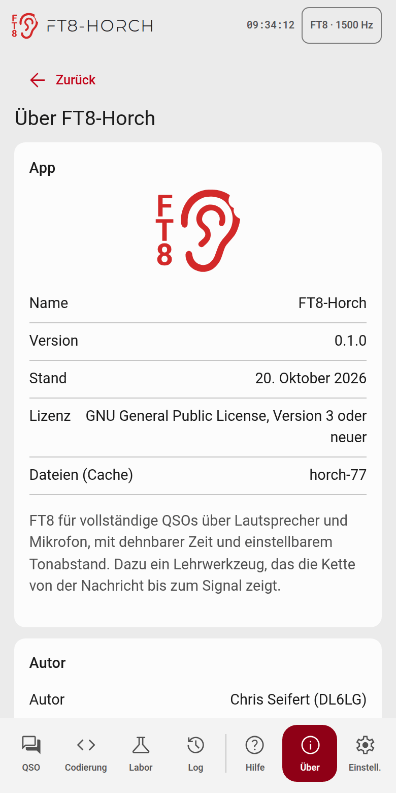

**Lizenz:** FT8-Horch ist freie Software unter der GNU General Public License, Version 3 oder neuer. Den Quelltext darfst du lesen, ändern und weitergeben, solange das unter derselben Lizenz geschieht.

**Datenschutz:** Alle Daten bleiben auf deinem Gerät. Es gibt keine Konten und keine Auswertung. Die einzige Anfrage, die die App stellt, ist die Frage an den eigenen Server nach der Uhrzeit bei der Zeitprüfung. Dein Log und das Protokoll liegen im Speicher des Browsers und verlassen das Gerät nur, wenn du sie exportierst.

**Danksagung:** FT8 stammt von Joe Taylor (K1JT), Steve Franke (K9AN) und Bill Somerville (G4WJS) und ist Teil von WSJT-X. Die Konstanten der App (Costas-Muster, Gray-Code, LDPC-Matrizen) stammen von dort und kamen über ft8_lib von kgoba (MIT-Lizenz) zu mir. Die Schrift ist Roboto, der Titel oben steht in Montserrat Alt1 (beide SIL Open Font License), die Symbole sind Material Symbols (Apache-Lizenz 2.0). Die Farben (neutrales Grau mit dem Rot `#c0001a`) berechnet ein kleines Skript im Quelltext, es braucht keine Bibliothek.

Das Ohr im Logo hat übrigens einen Biss. Das ist kein Fehler, das ist der Ohrenbeisser.

Die Rufzeichen in den Bildern dieser Anleitung sind Beispiele und nicht als echte Stationen gemeint. Autor der App ist DL6LG. Der Blog mit allem, was nicht in eine Anleitung passt, ist unter [ohrenbeisser.de](https://ohrenbeisser.de) zu finden.
