# FT8-Horch: the guide

*The manual for an app that was only supposed to be a small script.*

## How it came about

I have been into FT8 for a while. At some point it stops being enough that something works. You want to know *how*. So I worked my way through the specifications, which is about as exciting as it sounds, and then wrote the result out of my system in a blog article: [FT8 – Mathematik statt Watt](https://ohrenbeisser.de/ft8-mathematik-statt-watt/) (in German).

That could have been the end of it. It wasn't.

The plan was modest: a small script that shows how a message like `CQ DL6LG JO60` first becomes a bit pattern and then a signal. (The app can still do that today, it lives in the *Coding* tab.)

Then came the thought: if those are signals, you can make them audible. And if you can hear them, you can record them again with the microphone. And if you record them, you can try to decode them. And if that works ... well, you see where this is going. So why not a complete FT8 QSO right away?

That is how the small script turned into an app. It is called **FT8-Horch** ("Horch" is German for "listen"), and if you wonder whether it has grown a size too big: yes. But it really works, and for a project that started as "just a quick script" that is quite something.

## The essentials in three minutes

Not in the mood for manuals? Understandable. Here is the short version:

1. Tap **Settings** at the bottom, enter your callsign and your locator (for example `DL6LG` and `JO60`).
2. Turn on the **automatic time** on the device. The clock must be right to the second, more on that in a moment.
3. Back in the **QSO** tab, slide the **microphone switch** (crossed-out microphone on the left, microphone on the right) to the right and answer the microphone permission question with "Yes".
4. Put a second device with the app next to it (or play a real FT8 signal from a loudspeaker). When the other device calls CQ, the app answers by itself, because the **Auto-reply** switch above the band activity is on at start. Or you tap a line with a green edge. Done, the app runs the QSO on its own.

One device calling CQ and one answering: that is all it takes. The rest is polish.

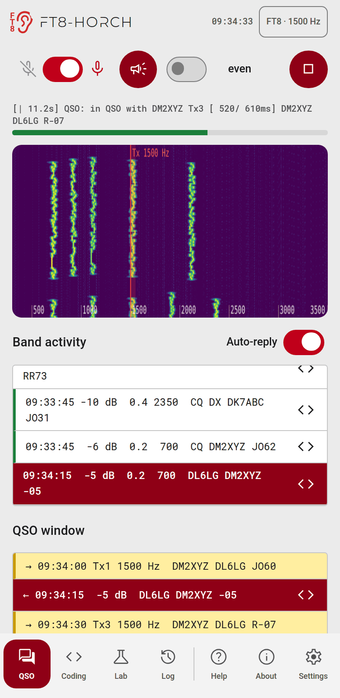

## What FT8-Horch can do (and what it had better not)

FT8-Horch runs FT8 QSOs over **loudspeaker and microphone**. No radio, no cable, no antenna mast. Two devices next to each other on the table are enough, or a phone and a PC. The app transmits, listens, decodes and answers following the usual rules of the auto sequence: from CQ to 73.

On top there are a few things you do not strictly need for the fun of it, but they are there:

* Time can be stretched (15, 30, 60 or 120 seconds) and the tone spacing can be set. That is called a *profile*.
* **Auto-reply** answers the first CQ the app hears, by itself.
* The *Coding* tab shows step by step how a message becomes tones and the other way round.
* The *Lab* measures level and delay and simulates signals with noise.
* A *Log* with ADIF export and import, a text protocol and a backup of all your data are there as well.
* In the *Lab* you can also test two devices against each other (**Connection test**), save recordings as WAV files and decode WAV files from elsewhere.

And now the honest limits, so you are not surprised:

* There are standard messages (callsign, locator, report, RR73, 73) and free text up to 13 characters. Callsigns with `/P` and particularly long or unusual callsigns (the ones with the hash trick, type 4) the app cannot do, and that is not planned either. It shows such messages as "not supported".
* On a crowded band FT8-Horch finds fewer messages than WSJT-X. In a comparison with 60 band recordings it was 67.7 percent of the messages WSJT-X found. WSJT-X has tricks like subtracting signals that are already decoded, which are missing here and not planned.
* The signal shape conforms to FT8: WSJT-X decoded a WAV file generated by the app. How the app does on a real radio I have not tried yet.
* I tested on a Pixel 10a, an old tablet with Android 10 and a PC, each with Chrome. On other devices and browsers it may behave differently, and on the iPhone I simply do not know.

## First steps

### Callsign and locator

You reach the settings at the bottom via **Settings**. Enter callsign and locator first. The locator has four characters, for example `JO60`.

If you do not know your locator by heart, tap the crosshair icon next to the field. The browser then asks for your location, and the app works out the locator from it. This happens only on your device, the coordinates are neither stored nor sent anywhere. You can overwrite the locator by hand at any time.

Changes apply immediately, there is no Save button. If callsign or locator are not valid, the app says so with a yellow band, and calling CQ does not work then.

Below that you set language (German or English) and appearance (follow the system, light or dark). In the **Automation** card you decide whether auto-reply skips stations that are already in your log: only those of today (UTC, the default), all from the whole log, or none. Here you also choose whether the app takes the other station's frequency when replying or keeps your own, and whether it keeps calling CQ after a QSO from your own CQ (more under "Calling CQ or replying").

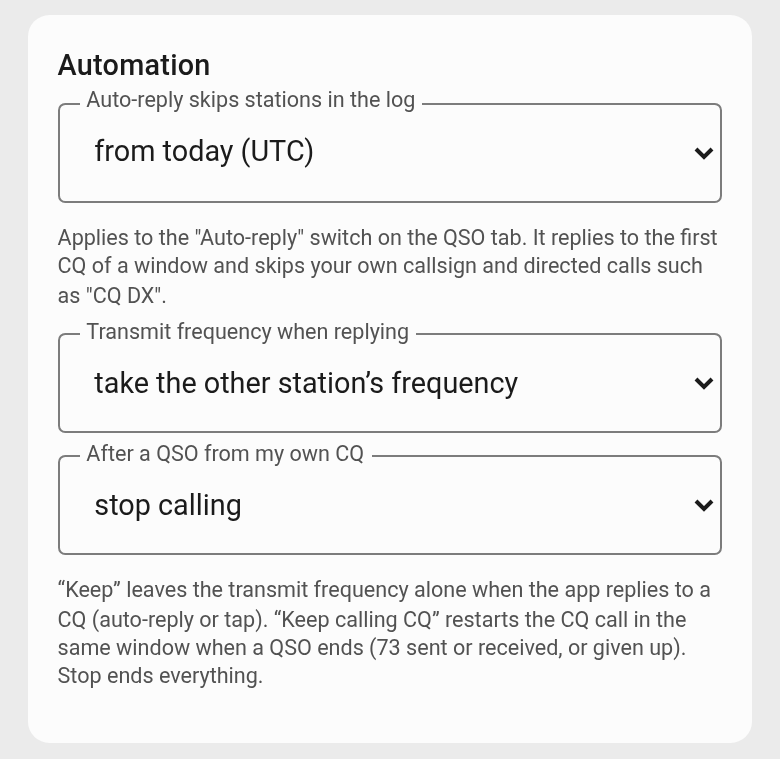

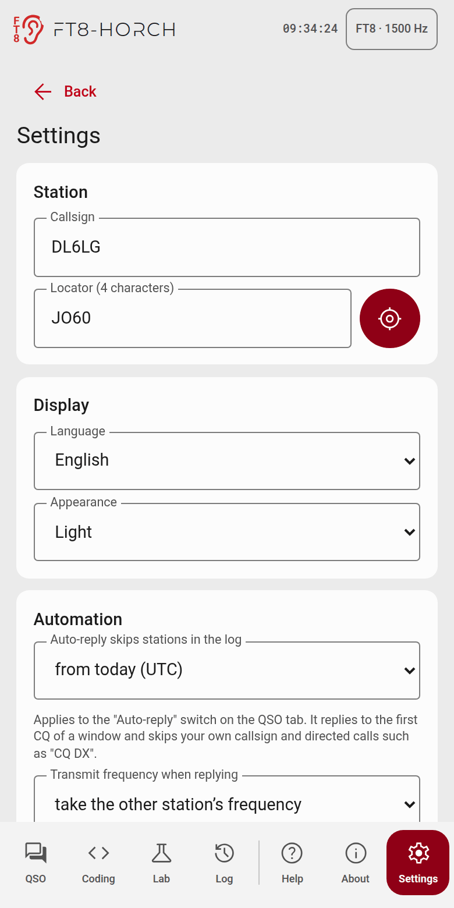

### The clock must be right

Now the topic I stumbled over myself: FT8 works in a 15-second rhythm by world time (UTC). All stations start transmitting in the same second and listen in the same second. If the clock of a device is wrong, the other's signal arrives too early or too late, and at some point not at all.

My test PC was once 18 seconds off. FT8 forgives a lot, but not 18 seconds.

So: turn on the automatic time on the device (on Android that is usually "Automatic date and time"). The app **never** changes the clock of your device, a web app is not allowed to. It always works with the system time.

What the app can do is check whether the clock is right. Under **Clock** in the settings, tap **Check clock**. The app then asks the server it was loaded from for the time nine times and works out how far off your device is. You get, for example, "Clock is fine (offset +0.1 s ± 0.1 s)". The "±" is the measurement uncertainty, so the check is accurate to about a tenth of a second, not to the millisecond. At start the check runs once by itself if you are online.

If the clock is off by more than 0.4 seconds, a warning band appears in the QSO tab. Then there is the emergency solution **Compensate in the app**: the app shifts its own clock by the measured offset until you reload the page. The device itself stays unchanged. It is better to set the clock correctly. The compensation is a plaster, not an operation.

If you do not want to press the compensation by hand every time, set the **Time source** in the **Clock** card from *Device system time* to *Server time*. Then the app asks the server for the time at start and every ten minutes after that and compensates the offset by itself, to about a tenth of a second. That is handy if the device clock is wrong or two devices cannot agree on the same time, because both then follow the same server. In the middle of a QSO the app changes nothing, so the windows do not jump. Without network it carries on with the system time and says so. The clock of the device stays untouched in any case.

A word of caution on the choice of source: the server time is only as good as the clock of the server the app was loaded from. With an ordinary web server that is no problem, but if you load the app from a self-run PC that is off, this setting does not help you.

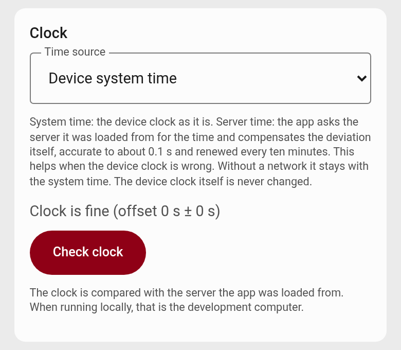

Where there is no network, the app cannot ask the server. It then reports "Clock check not possible (offline?)" and trusts your system time.

### Back up data

Log, protocol and settings live in your browser only. If you delete the "site data", change phones or the browser makes room when storage runs low, they are gone. Under **Settings, Back up data** there are two buttons against that:

* **Save backup** writes everything to a file `ft8-horch-sicherung_<date>.json`: all QSOs, the protocol and callsign, locator, language, appearance, profile, transmit frequency, time source and the auto-reply choice. Keep the file in a safe place. It also contains the callsigns of the stations you heard.
* **Restore backup** reads such a file again. You get a confirmation with the numbers first. It only adds: QSOs and protocol lines that are already there stay and are not created twice, the settings from the file are applied (an empty callsign and an empty locator overwrite nothing, time and tone spacing do not change during a QSO). The app skips unusable entries and counts them.

Below that it says whether the browser keeps the data **permanently**. The app asks the browser for that as soon as you save a QSO. Chrome decides on its own (an installed app and frequent use help). If it says "may delete", the backup matters all the more.

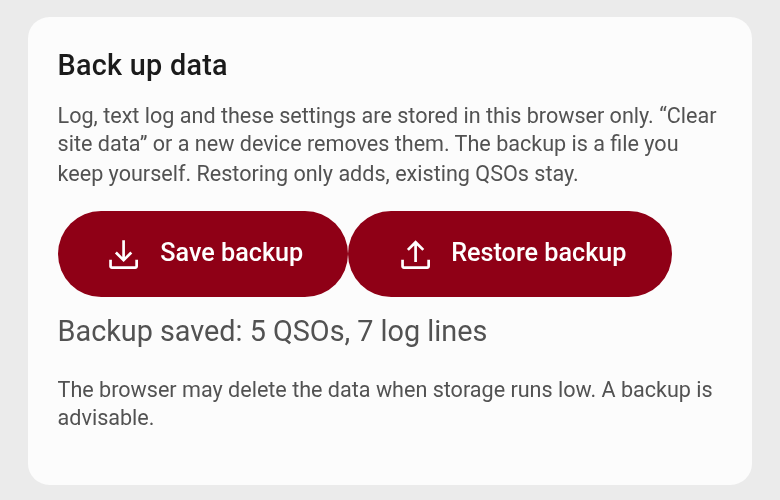

### As an app on the home screen

FT8-Horch is a PWA, that is a web page that behaves like an app. If you open it over a secure address (https) you can install it. It then gets the ear as its icon and starts without the browser bar.

There are two ways. At the very bottom of the **Settings** there is the **Install app** card. If installation is possible it has a button, otherwise it explains what you can do: in Chrome on Android you find it in the menu (the three dots) under **Install app** or **Add to home screen**, on the iPhone via the share icon of Safari and **Add to Home Screen**. In addition the app points this out to you **once** at the third start, with the buttons "Install" and "No thanks". After that it leaves you alone, promised. If the app is already installed it keeps quiet anyway.

On the first load the app stores all files in the cache of the browser. After that it also runs without network, only the clock check needs a connection.

When there is a new version, the app reloads by itself as long as the microphone is off and no QSO is running. Otherwise a notice appears to reload the page afterwards. Under **About** the line **Files (cache)** shows which version is loaded right now (for example `horch-80`).

## The interface at a glance

At the top is the header: logo and name on the left, world time (UTC) with seconds in the middle, the **profile chip** on the right. It shows which profile you are working with, for example "FT8 · 1500 Hz". A tap on it opens the profile settings. If the profile is not standard FT8 it says "FT8 variant" there, and on narrow screens the chip moves to a line of its own.

At the bottom (on wide screens on the left) is the navigation with seven entries: **QSO**, **Coding**, **Lab** and **Log** are the four main destinations. Behind the divider are **Help**, **About** and **Settings**, which open as pages of their own. The active entry has a red background. A tap on the entry of the open page or on "Back" takes you back to where you were before.

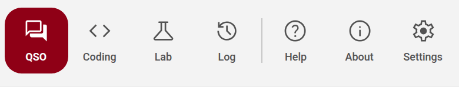

Whether light or dark is up to you in the settings. In the dark the red glows just like in the light, that is deliberately so. Surfaces and text are neutral grey, only the accents are red.

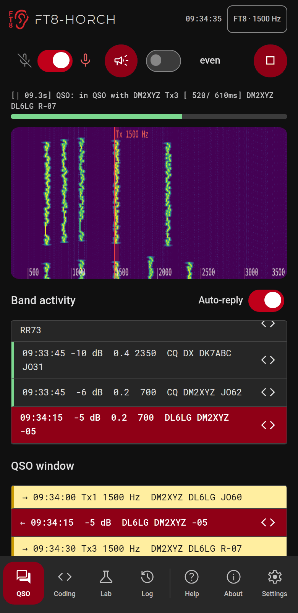

On wide screens (tablet in landscape, PC) the navigation is on the left, and band activity and QSO window sit side by side. On narrow phones everything is a bit smaller (90 percent) so more fits on the screen.

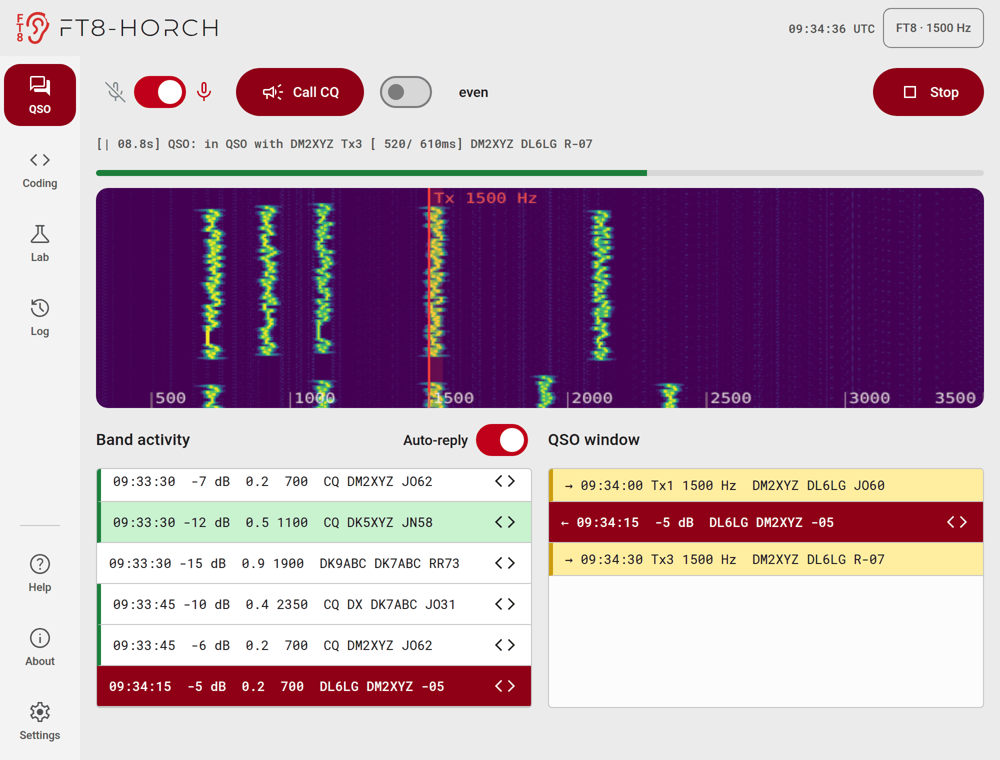

## Running a QSO

### Microphone, control bar and level

In the **QSO** tab you slide the **microphone switch** to the right. The browser asks whether the app may use the microphone, and it must, otherwise it hears nothing. At the same time the app prepares the sound output, because browsers only play sound if you tapped somewhere beforehand.

The app turns off echo cancellation, noise suppression and automatic gain of the device as far as the device allows. Those helpers are meant for phone calls and would rather ruin the FT8 tones. It also keeps the screen awake.

The control bar at the top of the tab has, from left to right: the **microphone switch** (crossed-out microphone on the left for "off", microphone on the right for "on"), the **Call CQ** button, a switch for the **CQ window** (even or odd) and, at the far right, the **Stop** button. With the microphone switch you also turn the microphone off again. The app then stops a running QSO and releases the screen. While the microphone is off, **Call CQ**, **Stop** and the **Auto-reply** switch are greyed out. **Stop** is, in addition, only active while you call CQ or a QSO is running.

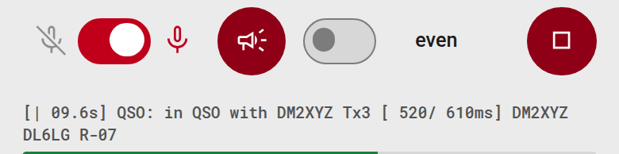

The status line shows, at the front in square brackets, the current time window and the time left: a vertical bar `|` means an even window, a slash `/` an odd window, followed by the seconds until the end, for example `[/ 03.5s]`. With the microphone on, the state follows ("QSO: ready", "calling CQ" or "in QSO with DL1ABC Tx3"), the decoder time for the early and the late pass in milliseconds (`[1234/2345ms]`) and, while you transmit, the message being sent. With the microphone off it says "Turn on the microphone". Below runs a thin **level bar**. It should be green and move when tones arrive. If it turns red it is too loud and the signal gets distorted. How to set the level properly is described further down under "Two devices, one table".

### Waterfall and band activity

The **waterfall** shows what the microphone hears: frequency runs horizontally from about 300 to 3500 Hz, time vertically. Dark violet is noise, yellow and green are signals. Every FT8 transmitter draws a wobbly trace through the picture, like in the image below.

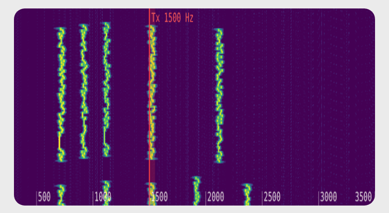

The red line labelled "Tx 1500 Hz" is the frequency **you** transmit on. If you double-tap into the waterfall (two quick taps at the same spot), it moves there. A single tap or a swipe to scroll changes nothing. Handy if you want to transmit in a gap between two other signals.

Below are the lists:

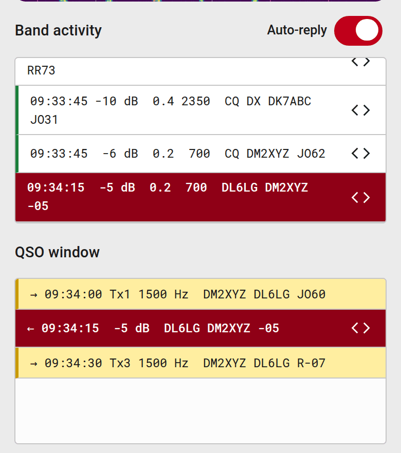

**Band activity** collects everything the app decoded. New lines are added at the bottom, the older ones move up (as in WSJT-X). Each line contains the time of the window in UTC, the signal-to-noise ratio in dB, the time offset DT in seconds, the frequency in Hz and finally the message. Lines with a green edge are CQ calls, a tap on them answers. If a line ends with "(late)", only the late decoding pass found the signal. Auto-reply does not answer such a CQ, because the answer would only go out a window pair (30 seconds) later. By tap it still works, the app then writes into the QSO window when it transmits. The colours of the lines (in band activity and in the QSO window): **red** is addressed to you, **yellow** is what you transmit, **white** (dark grey in the dark) is not about you, **light green** are callsigns you already have a QSO with in the log, and **light grey** are messages from the app itself.

The small icon with the angle brackets at the right of a line opens the *Coding* tab and shows you how the app decoded exactly this signal. A tap on the line itself still answers the CQ.

In the **QSO window** below there are only the messages that concern you: with an arrow to the right (→) what you transmit, with an arrow to the left (←) what arrives at your end.

### Calling CQ or replying

You have two options.

**You call CQ:** Tap **Call CQ**. With the switch next to the buttons (**even** or **odd**) you decide whether you transmit in the even or in the odd windows. With 15 seconds that means: even is :00 and :30, odd is :15 and :45. The app repeats the CQ call until someone answers or you tap **Stop**. It repeats it without a limit, it is stubborn that way.

**You reply:** Tap a CQ call in the band activity. The app sets your transmit frequency to the frequency of the caller and transmits in the respective other window, as it should. The QSO window says when it starts, for example "Reply to DM2XYZ (1730 Hz), sends 18:15:45 (in 12 s)".

**The app replies by itself:** Above the band activity sits the **Auto-reply** switch. If it is on and no QSO is running, the app answers the first CQ that the decoder finds in a window. Tapping a line still works as well. Your own callsign and directed calls such as "CQ DX" or "CQ NA" are skipped. Whether stations already in your log are skipped too is set in the settings under **Automation** (from today, from the whole log, or none). There you also decide whether the app takes the **other station's frequency** when replying or **keeps your own frequency**, and whether it **keeps calling CQ** after a QSO from your own CQ (after 73, after a given-up exchange or after the RR73 repeats, in the same window as before). Stop ends everything. Auto-reply only triggers after the early decoding pass, because a CQ found later does not reach the next transmit window any more. The switch is on after the app starts. You can turn it off at any time, then you only reply by tap. When the QSO is finished the app answers again at the next CQ right away. If it does not answer a CQ, it tells you why in the QSO window: "Auto-reply: CQ not answered, …" (a QSO is still running) or "CQ only found in the late pass".

Only one of you two transmits at the same time: whoever calls in the even window is answered in the odd window. That is all the magic that keeps both from talking at once.

### What happens in a QSO

The app follows the auto sequence of WSJT-X. The messages are called `Tx1` to `Tx6`:

| Message | Content | Example |
| --- | --- | --- |
| Tx1 | Reply to CQ, with locator | `DL1ABC DL6LG JO60` |
| Tx2 | Send report | `DL1ABC DL6LG -07` |
| Tx3 | Confirm report, send own | `DL1ABC DL6LG R-07` |
| Tx4 | Confirmation | `DL1ABC DL6LG RR73` |
| Tx5 | Closing greeting | `DL1ABC DL6LG 73` |
| Tx6 | General call | `CQ DL6LG JO60` |

If you call CQ it goes like this: you send Tx6, someone answers with Tx1, you send Tx2, get Tx3 back, confirm with Tx4, and the other side's 73 rounds the QSO off. If you reply yourself, you are up at Tx1, Tx3 and Tx5. The app works out the report from the measured signal-to-noise ratio of the other station, rounded to whole dB and limited to −30 to +32.

The status line above the level bar tells you where you are: "QSO: in QSO with DL1ABC Tx3" means you are in a QSO with DL1ABC and Tx3 comes next. The window in which you transmit is the opposite of the other station's window.

If the other station does not answer, the app repeats the message up to five times. It sends the RR73 up to three times if the 73 stays away. After that it gives up, with RR73 marked "unconfirmed". After a completed QSO the app transmits nothing more by itself. It does not secretly keep calling CQ just because you are bored. Unless you chose "keep calling CQ" in the settings under **Automation**, then it starts over after a QSO from your own CQ.

The QSO lands in the **Log** automatically, confirmed or unconfirmed. With **Stop** (far right, only active while you call CQ or a QSO is running) you stop the transmission and the QSO at any time.

On the technology behind it: the app decodes every window twice, once early (after about 13.7 seconds) and once at the end (after 15.05 seconds). Which message it sends next it decides 0.4 seconds before the transmit window. The status line then shows how long both passes took last time (`[ 520/ 610ms]`). The late pass does not hold up the transmission. If the early pass only finishes more than a second after the window start, the reply misses its window and goes out 30 seconds later. In my tests the decoder took about 1.0 to 1.3 seconds on the Pixel 10a, 0.9 to 1.5 seconds on the old tablet and much less on the PC. That is enough as long as no second pass shares the computing time.

## Profile: time and tone spacing

A tap on the profile chip in the header opens the profile settings. There you set:

* **Transmit frequency:** adjustable between 200 and 3000 Hz, 500 to 2700 Hz is sensible, the default is 1500 Hz. It is at the top of the dialog.
* **Time:** 15, 30, 60 or 120 seconds per window. That is the time factor.
* **Tone spacing:** from 6.25 to 100 Hz.

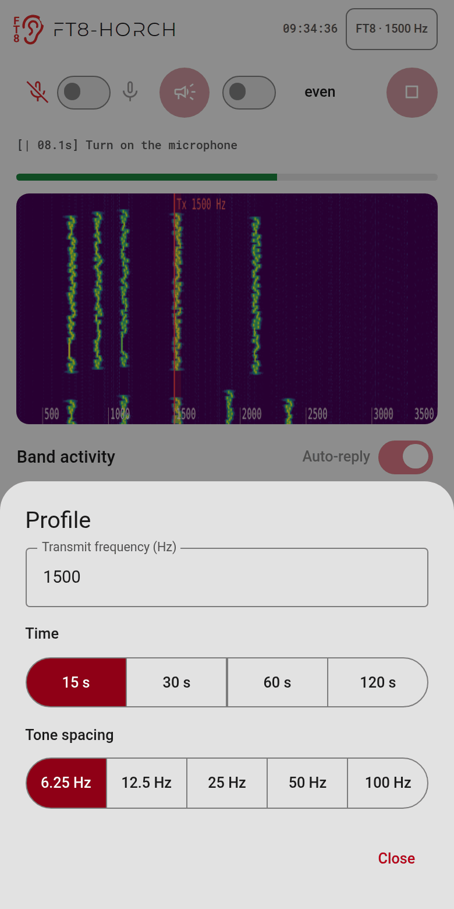

15 seconds with 6.25 Hz tone spacing is real FT8, the way WSJT-X knows it. Everything else is an **FT8 variant**. The app deliberately does not call it "FT8", because another device with WSJT-X does not understand it. With two devices that both use FT8-Horch it works, though, as long as **the same profile** is set on both sides. While a QSO or the connection test is running, time and tone spacing cannot be changed, the app then says "Press Stop first". The transmit frequency, on the other hand, you may move at any time.

What for? If you double the time you get about 2.5 to 3 dB more sensitivity, so the signal may sink deeper into the noise. With 120 seconds that is over 8 dB. In return a QSO takes correspondingly longer. Whether you need that when two phones lie next to each other on the table is another question. But you can.

The app warns you about settings that cause trouble: below 500 Hz a phone loudspeaker emits hardly anything, above 2700 Hz a radio clips the signal, and if the transmit band reaches beyond 5.5 kHz it no longer fits into the sampling.

## Two devices, one table

The normal case for this app: device A calls, device B answers, and the two chat in chirps over loudspeaker and microphone. Your neighbour will ask whether that is a new kind of bird. You can tell them it is mathematics.

A few experiences from my tests:

* **Close first, then further away.** At first put the devices a hand's width apart. In a quiet room I had a signal-to-noise ratio of 41 to 56 dB, FT8 needs only about −21 dB. So there is plenty of headroom.
* **Quiet is enough.** Set the volume of the transmitting device to medium and watch the level bar of the listening one. It should stay green. Red means overload, and that is too loud.
* **Do not transmit too low.** The loudspeakers of phones reproduce low tones weakly, at 500 Hz my measurement was missing 26 dB compared with 1500 Hz. The frequency response is bumpy elsewhere, too. At 1500 Hz everything is comfortable, which is why that is the default.
* **No headphones on the transmitting device.** Sounds trivial, but plugged-in headphones lead the sound past the loudspeaker.
* **Same settings.** Both devices need the same profile and the right time.
* **Check the connection.** If you want to know whether two devices fit together, use the **Connection test** in the Lab. It shows signal-to-noise ratio and DT for both directions.
* **Every device levels differently.** In my measurements the recording levels of the Pixel and the tablet were about 12 dB apart. That is no error, just a reason to use the level test in the Lab.

## Lab

The **Lab** tab holds the workshop. Here you measure whether microphone and loudspeaker play along, test two devices against each other, work with WAV files and try out how much noise the decoder can take. The cards are called Level test, Delay measurement, Connection test, WAV files and Simulator. All measurements only run while no QSO is running (otherwise the app asks you to tap **Stop** first).

### Level test

The app records two seconds of silence, then plays a test tone of 1500 Hz for three seconds and listens to it again with its own microphone. From both it calculates the noise floor, the level of the tone, the peak and the distance to the noise (referred to 2500 Hz bandwidth).

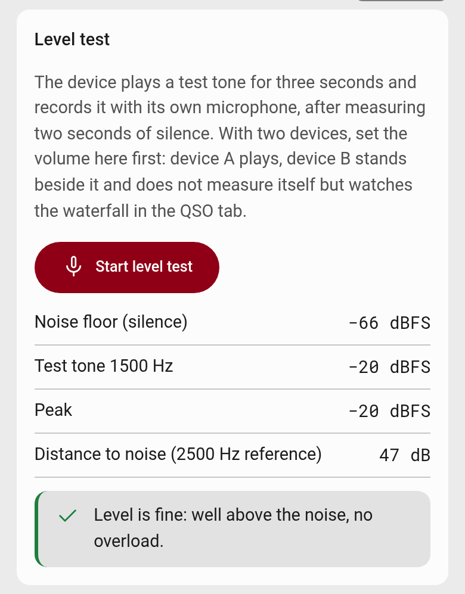

At the end there is a verdict: *fine* is everything clearly above the noise without overloading. *A bit high* means the peak is above −6 dBFS, the volume may come down a little. *Overloaded* is too loud. *Too quiet* means the distance to the noise is below 30 dB. *No tone* means the app did not hear its own tone, perhaps because of headphones or because the volume is at zero.

### Delay measurement

This is the measurement for everyone who wants to know why their devices cannot agree on DT. The app sends a short chirp (0.3 seconds from 600 to 2400 Hz) five times through its own loudspeaker to its own microphone and measures how far the recording time is from the planned transmit time.

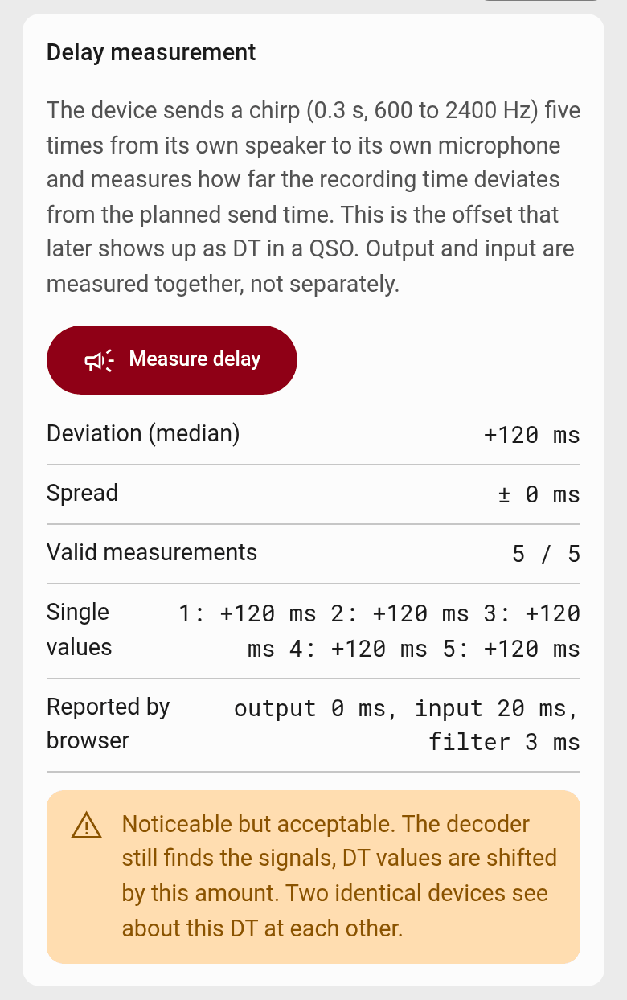

You get the median, the spread, the number of valid measurements and all single values. It also says what the browser knows about its own latencies. The result is the sum of output and input, exactly what later shows up as DT with two identical devices. Below 0.1 seconds it is not critical, up to 0.5 seconds it is acceptable, above that it gets too much.

### Connection test with a second device

The test replaces trying things out by hand when you put two devices next to each other. For both directions it measures how good the connection over loudspeaker and microphone is, and it separates the clock difference from the latency.

**Preparation:** Both devices have callsign and locator entered, the microphone on, the same profile (time and tone spacing) and enough volume. No QSO is running.

1. On one device you choose "Device A" under **Connection test**, on the other "Device B". The number of **Rounds** (2 to 10, default 4) must be the same on both.
2. Tap **Start test**, on both devices within a few seconds. The app shows the **start time in UTC**. It must be the same on both devices. If the devices show a different time, tap **Cancel test** and start again.
3. A sends a short text (`HORCH A 01`) in the even windows, B in the odd ones. Each device measures how it hears the other. After the rounds comes a pair of pause windows and then a pair in which each device sends its summary: how many messages it heard, with which signal-to-noise ratio and which DT.

With 15-second windows the test takes (2 · rounds + 4) · 15 seconds, so with 4 rounds two minutes. Meanwhile CQ, replying and auto-reply are locked, but the station keeps decoding.

**Result**, the same on both devices:

* **Received from device B:** how many of the rounds this device heard, mean signal-to-noise ratio, mean DT and its spread.
* **Device B hears this device:** the same from the summary of the other side.
* **Mean DT of both directions:** the clocks cancel out, what remains are the latencies of the two devices (playback and recording). If it is above 0.3 seconds the connection is too sluggish for FT8 (see Delay measurement).
* **Clock of this device against the other:** the difference between the two clocks, with sign. Plus means your own clock runs ahead. It also contains the difference of the latencies, so strictly speaking it is an upper bound for the clock error.

Findings in plain language come with it: Good (both directions arrive, DT and clock difference below 0.3 seconds), nothing heard, fewer than three of four messages decoded, latency too high, clocks different or summary not arrived. With **Save result as text** you put the numbers into a file, for example for the log of your tests.

If the summary of the other side does not arrive (for example because it was too loud over there), your device only shows its own direction. The other one is then on the other device.

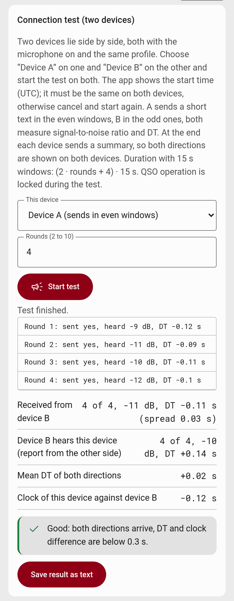

### WAV files

This is about files instead of air:

* **Save last window** stores the recording of the last complete window as WAV (12 kHz, 16 bit, mono). The microphone must be running for that. The file starts 2.5 seconds times kt before the window, so signals with negative DT are complete as well. Time factor, tone spacing factor and this lead are in the file name (`ft8-horch_aufnahme_20261021_080000_kt1_kf1_vorlauf2.5s.wav`).
* **Load WAV and decode** reads a file and shows what the decoder finds in it, with signal-to-noise ratio, DT, frequency and text. For a recording made by FT8-Horch the app takes kt, kf and lead from the file name. For files from WSJT-X or elsewhere the current profile applies and the lead you enter in the field (for WSJT-X: 0). Mono and stereo, 8 to 32 bit and other sample rates are no problem, the app converts to 12 kHz. The file may be at most four windows long. For longer recordings cut them first. Decoding may take a few seconds on a phone. With the icon at the right of the line you see how the signal was decoded in the Coding tab.

This helps with troubleshooting (a recording where something went wrong can be looked at in peace later) and with comparing against WSJT-X.

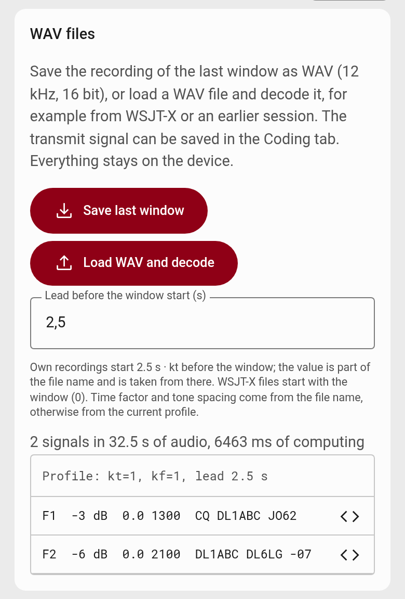

### Simulator

The simulator generates a signal in the device, mixes in noise, time offset, frequency offset and clock error and lets the real decoder loose on it. No loudspeaker, no microphone, no neighbours.

The **Single run** shows whether and how the message was decoded, plus DT, frequency, estimated signal-to-noise ratio and computing time.

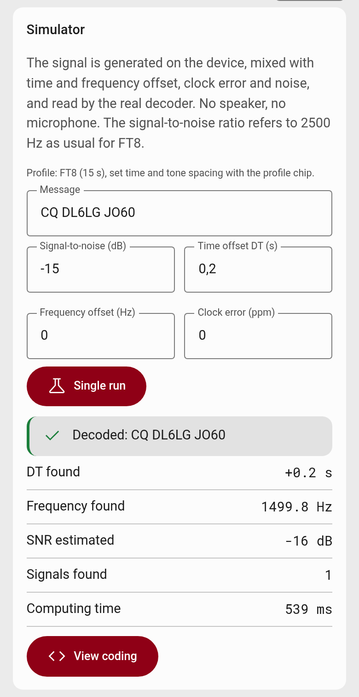

With the **View coding** button under the result you jump to the *Coding* tab and see how the decoder worked its way through the signal.

The **series** runs over several signal-to-noise ratios and several runs per value. You get a curve of the success rate, the 50-percent threshold and, if you choose all four time factors, the gain per doubling of time. A series can take a while, before the start there is a rough estimate, and with **Cancel** you stop at any time.

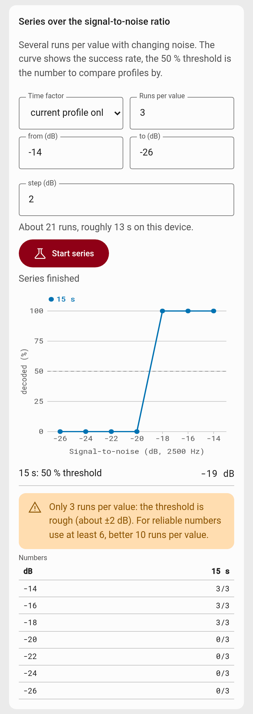

An honest note is also in the app: with fewer than six runs per value the threshold is only rough, the curve then jags quite a bit. Ten runs per value are better. In my test with a single run per value, 1.7 dB per doubling came out where it should be 2.5 to 3. That was no new physics, that was chance.

## Coding

The **Coding** tab is the place for everyone who started with me on the small script. At the top you switch between **Send** and **Receive**. Every card can be opened and has a "Read more" below the introductory sentence with a detailed explanation. It is quite detailed, I could not stop myself.

### Send: from the message to the signal

Type a message, for example `CQ DL6LG JO60`, and the app shows you eight cards:

1. the **fields** of the message (callsign, locator and a few flag bits),
2. the **77 bits**, divided into fields,
3. the **CRC-14**, a checksum that appends 14 bits,
4. the **LDPC code**, which turns 91 bits into the 174 bits of the codeword,
5. the **error protection to try out** (more on that in a moment),
6. the **triples** and their tones,
7. the **79 symbols** with the three Costas blocks,
8. the **signal** as a spectrogram, which you can also listen to with "Play". With "Save as WAV" you get the whole window as a file (12 kHz, 16 bit, mono, start 0.5 s after the window start). You can open it in WSJT-X and check whether it understands the signal. The file name gives text, frequency, kt and kf.

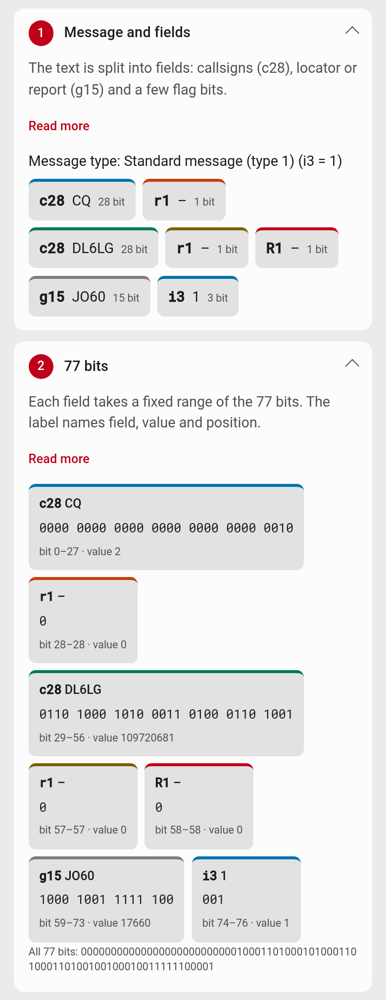

Messages the app cannot pack (callsigns with `/P`, hash callsigns, free text with more than 13 characters) it reports with an understandable note instead of simply doing nothing.

### Error protection to try out

This is my favourite toy. In the fifth card you see all 174 bits of the codeword. Tap single bits to flip them, or let the app build in random errors. Below you see how many parity equations are violated, how many rounds the decoder needs and whether it gets rid of the error again.

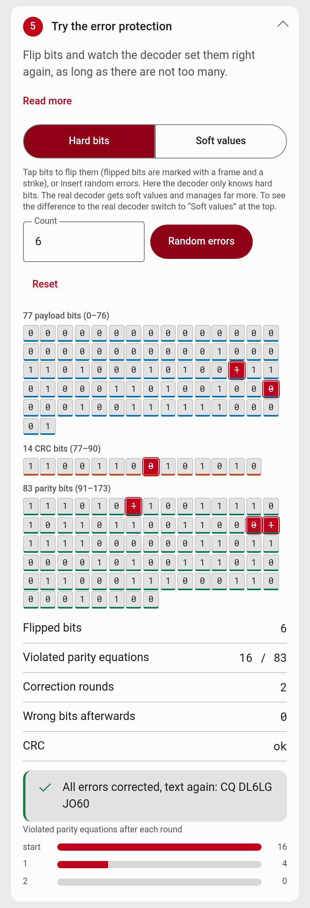

Flipped bits are marked with a frame and a stroke, so you can find them without colour vision as well. For a feeling of the orders of magnitude: up to four flipped bits the decoder always corrects, with ten in about 95 of 100 cases, with fifteen only in about one in nine, from twenty not at all. That holds for this teaching view with hard bits. The real decoder gets more information and manages considerably more.

How much more is shown by the **Soft values** switch above the grid. The app then simulates a radio channel with adjustable signal-to-noise ratio and gives the same disturbance to two decoders: one that only knows the hard bits (a bit is 0 or 1), and one that also gets the certainty for every bit. In the grid the bits the noise got wrong are framed. With "Count 100 runs" you see the success rate. At −19 dB (standard profile) the soft decoder manages roughly nine of ten runs, the hard one about every third. The numbers come from a simplified channel model (noise only, no fading or delay effects), a real radio path is less friendly. With stretched time the model is too optimistic: at kt = 8 it predicts a threshold of about −29 dB, the real decoder managed −27.3 dB in the measurement.

### Receive: from the signal to the message

The **Receive** view shows how the app found and read a decoded signal. You get there via the icon with the angle brackets on a line of the band activity or after a single run in the simulator.

Five cards tell the story: **Signal found** (time, frequency, signal-to-noise ratio), **Tone powers** (the power of all eight tones in each of the 79 symbols), **LLR of the 174 bits** (for each of the 174 bits a soft value, how sure the app is), **Belief propagation** (the parity equations negotiate until all of them hold) and **CRC and text** (checksum recomputed, message read).

, read by the decoder.")

With weak signals you see the errors the noise built in and how the error correction irons them out again. In one of my runs at −18 dB only 72 of 79 symbols had the right strongest tone, the correction flipped eight bits, and in the end the right message stood there anyway.

## Log and protocol

In the **Log** tab there are two views: the completed QSOs and the text protocol.

Under **QSOs** every completed QSO is listed with time, callsign, locator and the two reports. A QSO without the closing 73 is marked "unconfirmed". You can search by callsign, locator and note, filter by confirmed or unconfirmed and narrow the period. The two date fields are pre-filled with your first and last entry, without entries they show today's date.

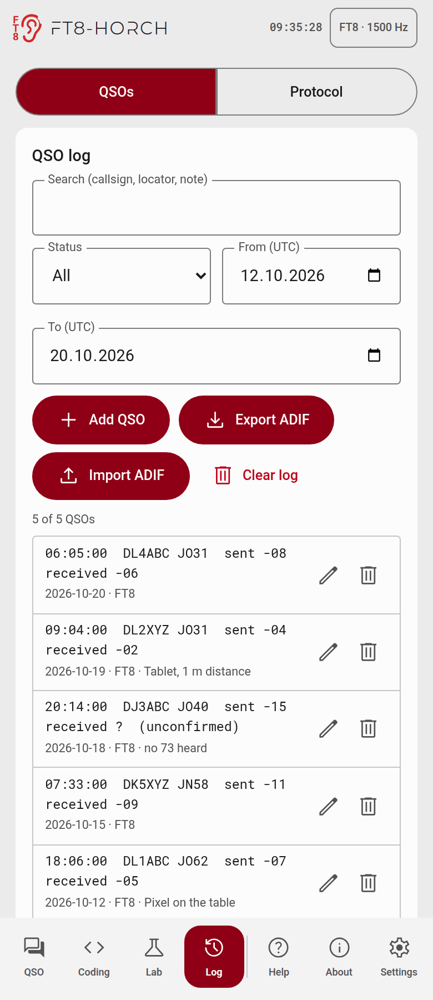

With **Add QSO** you enter a QSO by hand, for example one you ran with WSJT-X or one that did not land in the log after a crash. You give date, start and end (UTC), callsign and, if you know them, locator, reports and note. If the end is missing the app takes two minutes after the start. Such entries carry the mark "by hand", and the ADIF file mentions it in the comment.

With the pencil you open an entry for editing (callsign, locator, reports, confirmed or not, a note), with the wastebasket you delete it after a confirmation.

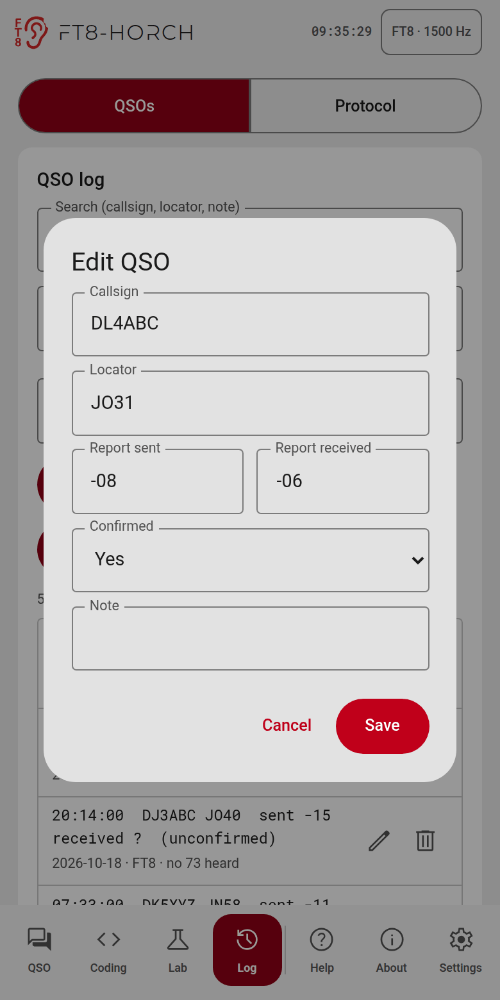

**Export ADIF** writes all QSOs to a file `ft8-horch_<date>.adi` that you can load into other logbook programs. Because the QSO took place over a loudspeaker and not over a band, the file contains neither frequency nor band (except for entries you imported from an ADIF file). Real FT8 is in there as `FT8`, every variant as `MFSK` with a note in the comment. Whether your logbook program copes with that I have not checked yet.

**Import ADIF** reads an ADIF file, for example the WSJT-X log (`wsjtx_log.adi`) or an earlier file from FT8-Horch. Only FT8 QSOs (and FT8 variants from FT8-Horch with their profile) are taken over, other modes the app counts and leaves out. Band and frequency are kept and are in the file again at the next export. A QSO with the same station and a start at most two minutes away from an existing one counts as a duplicate and is not created again. Imported entries carry the mark "imported". Below the button it says how many QSOs were taken over and how many were not.

The **protocol** is the list of all decodes and transmissions with time, report, DT, frequency and text, the way you know it from WSJT-X. You can filter by Received, Sent and "My QSO", search in the text and export the whole thing as a text or CSV file. The last 5000 lines are stored. Because the callsigns of other stations are in there, too, the protocol stays on your device until you export it yourself.

The app also searches the protocol for exchanges that are not in the log (for example because the other station never sent the 73). If it finds any, a card "QSOs found in the protocol" appears at the top of the protocol. With the plus you take over an exchange: callsign, locator, reports and times are already filled in, you check them and save. An exchange counts as found if you and the other station each sent at least one message. Pauses of more than five minutes separate two exchanges. It counts as confirmed only if the other station sent RR73, RRR or 73.

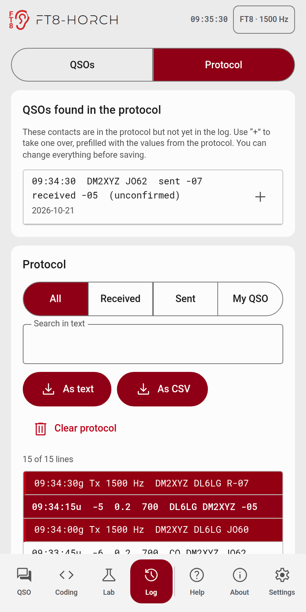

## When nothing works

A small catalogue of the usual suspects.

**The microphone does not turn on.** The browser denied the permission or has not asked yet. Check in the site settings of the browser whether the microphone is allowed. Also, the browser demands a secure connection (https) or `localhost` for the microphone.

**The waterfall stays black.** Is the microphone running (switch at the top left slid to the right, the status line then says "QSO: ready")? Does the level bar move? Sometimes another app has taken the microphone.

**Nothing arrives.** Check volume and distance, do the level test in the Lab, see whether headphones are plugged in. In a loud environment it helps to move closer.

**Something arrives but is not decoded.** Then most of the time the clock or the profile is to blame. Both devices need the same settings and the right time. Look in the protocol at how big DT is in the lines. If it is permanently one second or more, something is wrong with the clock or the delay, then the clock check and the delay measurement help.

**The app does not answer a CQ.** Look into the QSO window: if it says "Auto-reply: CQ not answered, …", a QSO is still running. If it says "CQ only found in the late pass" or the line has the suffix "(late)", the signal was too late. Then a tap on the line helps. Also check that the microphone is on (the **Call CQ** and **Auto-reply** switches are greyed out otherwise) and that the callsign of the caller is not the same as your own.

**The reply comes 30 seconds too late.** The app only transmits if the early decoding pass is finished at most one second after the window start. Look in the status line at how long it takes (`[ 520/ 610ms]`), and at DT in the protocol. If DT is large the signal arrives too late, then the delay measurement in the Lab helps.

**The QSO breaks off.** Does the other station have the same profile? Do you transmit in the right window? The caller transmits in the chosen window, the one replying automatically in the other. If the decoder shows long computing times the reply may come one window too late.

**The app shows an old version.** Under **About** the line **Files (cache)** shows which version is loaded. If it is not the expected one, reload the page in the browser (twice if necessary). With the microphone running or a QSO going the app does not reload by itself, then only a notice appears.

**The connection test does not start or the times do not match.** Callsign and locator must be entered (otherwise the station does not run), the microphone must be running and no QSO may be running. The start time (UTC) must be the same on both devices. If it differs, tap **Cancel test** on both devices and start again, this time as simultaneously as you can. Both devices also need the same number of rounds and the same profile.

**Load WAV says "too long".** The file may be at most four windows long (a little over a minute with 15-second windows). Cut it beforehand.

**Restore backup does not work.** The file must come from FT8-Horch (extension `.json`), and the app reading it must not be older than the one that wrote it. The app skips unusable entries and counts them.

**The location does not work.** The browser did not grant the permission, or the device finds no signal. You can enter the locator by hand at any time.

**"Callsign or locator invalid".** Callsigns need at least three characters made of letters, digits and the slash, locators have four characters in the pattern letter (A to R), letter (A to R), digit, digit (for example `JO60`).

## A small FT8 dictionary

For everyone who only landed here by chance.

| Term | Meaning |
| --- | --- |
| CQ | "Hello, is anyone there?" The general call. |
| QSO | A radio contact, here a sequence of five to six messages. |
| UTC | World time. All FT8 clocks run by UTC. |
| Window (slot) | A 15-second section. Even windows start at :00 and :30, odd ones at :15 and :45. |
| Locator | A grid square on Earth, four characters like `JO60` (Maidenhead system). |
| Report | The signal level of the other station in dB, for example `-07`. With an "R" in front: confirmed. |
| SNR | Signal-to-noise ratio. How far the signal is above the noise, referred to 2500 Hz bandwidth. |
| DT | The time offset between signal and expected start, in seconds. |
| f0 | The frequency of the lowest of the eight tones. |
| Profile | Time and tone spacing. 15 s and 6.25 Hz are standard FT8, everything else is a variant. |
| Pass | One decoding run. The app decodes every window twice: early (13.7 s) and at the end (15.05 s). |
| Auto-reply | The app answers the first CQ by itself as long as no QSO is running. |
| Costas pattern | Seven tones in a fixed order that occur three times in the signal, so the receiver finds time and frequency. |
| CRC | A checksum that catches wrong messages. |
| LDPC | The error protection that turns 91 bits into 174. |
| LLR | A soft value per bit: how sure the receiver is whether it was a 0 or a 1. |
| RR73, 73 | Confirmation and closing greeting. 73 means "best regards". |
| ADIF | An exchange format for logbooks. |
| Connection test | Two devices send each other a short text in turn and measure how well they hear each other. Device A sends in even, device B in odd windows. |
| WAV | An audio file. FT8-Horch stores and reads it at 12 kHz, 16 bit, mono (the app converts other formats). |

## Licence, privacy and thanks

Under **About** you find version, licence, author and acknowledgements once more in one place.

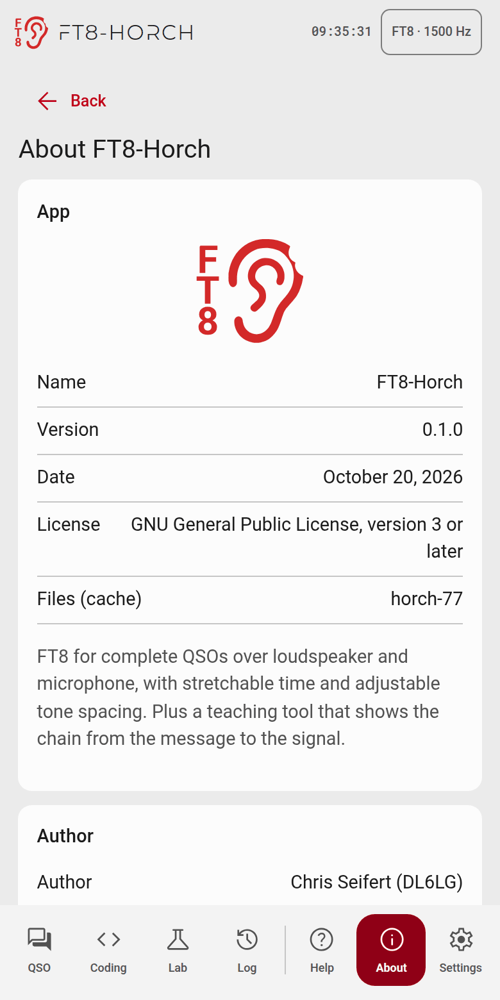

**Licence:** FT8-Horch is free software under the GNU General Public License, version 3 or later. You may read, change and pass on the source code as long as that happens under the same licence.

**Privacy:** All data stays on your device. There are no accounts and no analytics. The only request the app makes is the question to its own server for the time during the clock check. Your log and the protocol live in the memory of the browser and leave the device only if you export them.

**Thanks:** FT8 comes from Joe Taylor (K1JT), Steve Franke (K9AN) and Bill Somerville (G4WJS) and is part of WSJT-X. The constants of the app (Costas pattern, Gray code, LDPC matrices) come from there and reached me through ft8_lib by kgoba (MIT licence). The font is Roboto, the title at the top is set in Montserrat Alt1 (both SIL Open Font License), the icons are Material Symbols (Apache License 2.0). The colours (neutral grey with the red `#c0001a`) are computed by a small script in the source code, it needs no library.

By the way, the ear in the logo has a bite taken out. That is no mistake, that is the "Ohrenbeisser" (German for earwig, literally "ear biter").

The callsigns in the pictures of this guide are examples and not meant as real stations. The author of the app is DL6LG. The blog with everything that does not fit into a guide can be found at [ohrenbeisser.de](https://ohrenbeisser.de) (in German).
